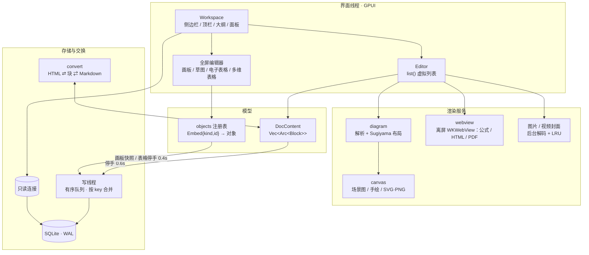

# 石渠 Stonebrook

[English](README.en.md)

> 藏书于石，引水成渠。

纯本地的块级文档编辑器，用 **Rust + [GPUI](https://github.com/zed-industries/zed)**（Zed 的 GPU UI 框架）编写，Metal 直接绘制。
交互与界面自成一体：块编辑、`/` 斜杠菜单、浮动工具栏、网页粘贴即还原，外加画板、草图、电子表格、多维表格四个全屏编辑器。
没有账号、没有云端，数据只在本机一个 SQLite 文件里（只有「网页卡片」和「检查更新」会联网，可在设置中一键关闭）。


- 版本 **2.3.0**，仅支持 macOS 12+（依赖 AppKit、WKWebView、AVFoundation）
- 完整功能清单：[docs/FEATURES.md](docs/FEATURES.md)
- 官网：<https://davidzhanghui.github.io/stone-book/>

<p align="center">
  <a href="docs/stonebrook-promo-v2.2.mp4"></a><br>
  <a href="docs/stonebrook-promo-v2.2.mp4">▶ 观看宣传片</a> · <sub>72 秒：按块书写 · 网页粘贴还原 · 流程图与公式 · 画板 · 草图 · 电子表格 · 多维表格 · 数据只在本机</sub><br>
  <sub>配乐：“Awakening Dew” by <a href="https://soundcloud.com/keysofmoon">Keys of Moon</a>（<a href="https://creativecommons.org/licenses/by/4.0/">CC BY 4.0</a>）</sub>
</p>

## 能做什么

| 方向 | 内容 |
|---|---|
| 文档编辑 | 六级标题、多级列表与待办、引用、高亮块、代码块（19 种语言高亮）、表格、分栏、图片裁剪缩放；Markdown 快捷语法；评论；同步块；模板 |
| 粘贴与导出 | 从网页粘贴还原格式；复制同时写出 HTML + Markdown；导入 Markdown，导出 Markdown / HTML / PDF |
| 图表与公式 | 自研 Mermaid 风格渲染器（流程、时序、类、状态、ER、甘特、饼图、思维导图、时间线）；KaTeX 块级与行内公式 |
| 画板 | 图形、连线、便签、分区、泳道、画笔、思维导图、约 2.3 万个素材、60 个模板；Mermaid / PlantUML 转可编辑图形 |
| 草图 | Excalidraw 兼容的手绘白板：箭头绑定、容器文字、框架；`.excalidraw` / Obsidian 文件与官网剪贴板双向互通 |
| 电子表格 | IronCalc 公式引擎（497 个函数）、条件格式、数据验证、下拉列表、筛选排序、冻结、多工作表、xlsx / CSV |
| 多维表格 | 21 种字段、公式与关联引用；表格 / 看板 / 画册 / 甘特 / 日历 / 表单六种视图；行列双向虚拟滚动，附 10 万行压测 |
| 富内容 | 网页卡片、视频、文件附件（代码 / PDF / Office / 音频 / 压缩包预览）、HTML 块、倒计时、按钮、时间轴 |
| 效率 | 文档树与回收站、全文搜索（FTS5）、命令面板（拼音）、大纲、演示模式、专注模式、写作热力图 |

## 快速开始

环境：macOS、Rust 1.85+（`rustup update`）、Xcode 命令行工具（`xcode-select --install`）。
不需要 Metal 工具链（启用了 GPUI 的 `runtime_shaders`，着色器在运行时编译）。

```bash
cargo run --release            # 直接运行（带开发功能）
scripts/build.sh               # 一键构建：格式 / clippy / 测试 → release → dist/石渠.app + DMG
scripts/build.sh --fast --run  # 跳过检查只打包，并启动（已运行的会先退出）
```

`scripts/build.sh` 选项：

| 选项 | 作用 |
|---|---|
| `--fast` | 跳过 `cargo fmt --check`、clippy 与单元测试 |
| `--dev` | 正式包里也带上开发功能（脚本测试、压测菜单） |
| `--no-dmg` | 只生成 `dist/石渠.app` |
| `--run` | 打包后启动 |

产物用 ad-hoc 签名，首次打开可能需要在「系统设置 → 隐私与安全性」中放行。

**应用内更新**：每天最多检查一次 GitHub Releases 的最新版本（「设置 → 更新」可关闭自动更新，或点「检查更新」；菜单「石渠 → 检查更新…」）。发现新版本后在后台下载本机架构的 `.app.zip`，按发布里的 `SHA256SUMS.txt` 校验，校验不过不安装；下载好后点「重启并安装」，或者下次正常退出时自动替换。旧版本保留在 `<数据目录>/updates/previous.app`。只有从 `.app` 启动时才能自动安装（`cargo run` 只下载）。

## 数据与可靠性

- **位置**：`~/Stonebrook/`（环境变量 `STONEBROOK_DATA_DIR` 可覆盖）：`stonebrook.db` + `assets/` 资源目录，复制即备份。
- **完整备份 / 恢复**：「文件 → 导出完整备份…」（或 `···` 菜单、命令面板）打包 `stonebrook.db` 快照 + `assets/` 为一个 zip；「从备份恢复…」校验后暂存，**重启后生效**，原数据移到 `recovery/pre-restore-<时间>/`，不会删除。数据库里引用资源一律存相对路径（`stonebrook://asset/<文件名>`，内存里才展开成绝对路径），所以整个数据目录可以随意搬家、换机器，不用改写。
- **写入**：所有写操作进同一个后台写线程，按提交顺序执行；文档与嵌入对象的保存按 key 合并，只写最新快照（合并后的任务排到队尾，不会越过之前提交的写入）。界面线程用另一条只读连接（`query_only`，WAL 模式下读写互不阻塞）。单个写任务出错或崩溃不会影响后续保存；退出、关窗口前等写队列清空（最多等 10 秒，超时会提示）。
- **失败可见**：写库失败、读取失败、序列化失败都会在界面顶部提示原因；序列化失败时不写入，不会用空内容覆盖原数据。
- **损坏保护**：文档 JSON 无法解析时，原文备份到 `recovery/`，打开一篇说明文档，不会把空内容写回去覆盖。画板 / 草图 / 电子表格 / 多维表格的数据无法解码时，原始字节同样备份到 `recovery/`，并拒绝打开编辑器（不会出现「空白画板」）；多维表格里个别读不出来的数据表 / 行会跳过并提示，原始数据保留不动。
- **向前兼容**：旧版本读到新版本的块类型时原样保留；读到已有块上的新字段也会原样写回。
- **升级**：表结构用 `PRAGMA user_version` 记版本，启动时按顺序执行 `store::MIGRATIONS` 里的升级脚本；执行前先把数据库复制到 `recovery/pre-migrate-v<N>-<时间>.db`。数据库来自更新版本时拒绝打开并提示升级。
- **回收**：启动时后台删除 7 天以上没被文档（含回收站）、用户模板、同步块引用的嵌入对象；`assets/` 里 7 天以上没被任何数据引用的文件同样回收；`cache/`（视频封面、网页快照等可重建的缓存）超过 512MB 时按最近修改时间淘汰到 80%。
- **内存**：嵌入对象、网页卡片、附件缩略图、波形、公式、图标等缓存都是带容量的 LRU（`src/lru.rs`），长时间使用不会只涨不降；还有未保存修改、或正被编辑器使用的对象不会被淘汰。
- **WebView 隔离**：所有离屏 / 内嵌 WKWebView 用非持久化数据仓库（不留 Cookie / LocalStorage），并挂导航代理：页面只能在本地内容内跳转，点外链交给系统浏览器打开；网页卡片抓取拒绝内网 / 回环地址，重定向逐跳检查。

## 架构



设计要点：

- **文本槽（slot）**：每个可编辑区域是一个槽（普通块 1 个、表格每格 1 个、分栏每栏 1 个），光标 = `(块, 槽, UTF-8 偏移)`。
- **渲染**：选区、输入法组字、查找高亮、语法高亮（按内容缓存）都折叠进 `TextRun`；虚拟列表让绘制成本只和可见内容有关。光标只在窗口聚焦时闪烁。
- **撤销**：文档是 `Vec<Arc<Block>>`，快照只拷贝指针；撤销栈有上限，超出时从队头丢弃。
- **嵌入对象**：画板、电子表格、多维表格以 `Embed{kind,id}` 块引用独立对象，对象单独存表。画板是不可变快照，交给写线程序列化；电子表格原地修改，停手后再编码入队；多维表格按字段 / 记录 / 视图逐行写。
- **同步块**：同一 `sync` id 的连续块构成同步组，保存时写入同步表，打开文档时用最新内容替换。
- **文档格式**：块 JSON 带版本号；旧版本读到不认识的块降级为「不支持的块」但保留原数据。

## 源码导览

| 路径 | 说明 |
|---|---|
| `src/main.rs` | 启动、快捷键与菜单、退出前 `flush_all` |
| `src/store.rs` | SQLite：写线程与合并队列、迁移、全文搜索、评论 / 模板 / 同步块 / 键值 |
| `src/model.rs` | 块与富文本模型、JSON 序列化与版本兼容 |
| `src/objects.rs`、`src/embed.rs` | 嵌入对象注册表（`ObjKind`）、保存策略、对象 LRU 缓存与回收；四个全屏编辑器的统一接口 `EmbedEditor` |
| `src/assets.rs`、`src/lru.rs` | 资源相对路径（持久化边界转换）、assets 回收与 cache 淘汰；通用 LRU |
| `src/updater.rs` | 应用内更新：查 Releases、下载校验、退出后替换 `.app` |
| `src/editor/` | 文档编辑器（状态拆成 `EditCore` 选区与撤销 / `DocSession` 换文档即重置的界面状态 / `RenderCaches` 渲染缓存 / `ToolbarState`）：`ops` 编辑操作、`nav` 光标与命中、`clip` 剪贴板、`input` 输入法、`render` 块渲染，`table_render` / `menus_render` / `toolbar_render` 表格、菜单、工具栏，`attach` / `media` / `fileview` 附件与视频 |
| `src/workspace.rs`、`src/workspace/` | 主窗口；设置、命令面板、演示、PDF 导出、写作统计 |
| `src/convert.rs` | HTML / Markdown 导入导出（网页粘贴还原） |
| `src/canvas/`、`src/diagram/` | 2D 场景图与绘制，`canvas::math` 是画板与草图共用的几何（点线距离、多边形命中、缩放手柄、对齐 / 分布）；Mermaid / PlantUML 解析与分层布局 |
| `src/board/` | 画板 / 流程图 / 思维导图的模型与全屏编辑器 |
| `src/sketch/` | 草图（Excalidraw 兼容）：官方 `.excalidraw` 模型、手绘渲染、导入导出与全屏编辑器 |
| `src/sheet/` | 电子表格界面（`commands` 静态命令表、`mouse` 鼠标交互、`paint` 绘制；计算由 IronCalc 完成） |
| `src/base/` | 多维表格：`model` 数据与撤销、`db` 逐行存储、`formula` / `calc` 公式与视图计算、`editor` / `chrome` 界面 |
| `src/highlight.rs` | 代码高亮（代码块、文本框、附件预览共用） |
| `src/webview.rs`、`src/math.rs`、`src/linkcard.rs`、`src/media.rs` | 离屏 WebView、KaTeX、网页卡片抓取（支持系统代理）、视频 |
| `src/autotest.rs`、`src/*/script.rs` | 脚本驱动的端到端测试（`dev` feature） |
| `vendor/` | 打了补丁的 GPUI 0.2.2 与 IronCalc 0.9.1，见 [docs/VENDOR_PATCHES.md](docs/VENDOR_PATCHES.md) |

代码约 10.6 万行 Rust。主要依赖：`gpui`、`ironcalc`、`rusqlite`（内置 SQLite，含 FTS5）、`roughr`（手绘风格）、`resvg`、`pulldown-cmark`、`scraper` + `ureq`（网页卡片）、`symphonia`（音频）、`objc2-*`（系统接口）。release 二进制约 37MB。

## 开发

```bash
scripts/check.sh                    # 提交前检查：fmt + clippy 零警告 + 全部测试（CI 跑的也是它）
git config core.hooksPath scripts/hooks   # 可选：每次提交前自动跑 check.sh
cargo test                          # 单元测试
cargo fmt                           # 格式化（rustfmt.toml：max_width = 160）
cargo build --no-default-features   # 不含开发功能的构建（正式包用这个）
```

**编辑内核随机测试**（`src/editor/fuzz_tests.rs`）：用 GPUI 的无头 `TestAppContext` 驱动真实的 `Editor`，从一篇覆盖各种块的种子文档出发做随机编辑，每一步检查文档不变量、存盘再读回不变、阅读模式下改不了文档，最后撤销到底回到种子文档。结果可复现，失败时打印种子与最近的操作：

```bash
STONEBROOK_FUZZ_SEEDS=2000 STONEBROOK_FUZZ_STEPS=300 cargo test --release random_edits   # 加大强度
STONEBROOK_FUZZ_SEED=17 cargo test random_edits                                          # 复现某个种子
```

**格式往返**：`tests/fixtures/all-blocks.json` 收录每种块的规范写法，必须读入再写出不变；新增块类型时编译器会提醒把它加进去（`STONEBROOK_WRITE_FIXTURE=1 cargo test all_blocks_fixture` 重新生成）。

**截图回归**：`tools/harness/compare.py` 用同一份脚本分别跑新旧两个版本、逐像素比较，只改代码不改外观的重构应当每张一致，见 [tools/harness/README.md](tools/harness/README.md)。

Cargo feature `dev`（默认开启）包含：脚本驱动测试、压测数据生成器和压测菜单入口。正式包用 `--no-default-features` 构建，不包含这些代码。

**端到端测试**：`STONEBROOK_SCRIPT=脚本文件` 启动后，通过 GPUI 自身的事件管线注入按键、输入法、鼠标事件，走的是真实的快捷键匹配与输入路径：

```text
key cmd-n                  # 按键
type 你好 **粗体** 世界      # 逐字输入（会触发 Markdown 快捷语法）
ime nihao / commit 你好     # 输入法组字 / 上屏
click 400 300 2            # 双击
html ./sample.html         # 把 HTML 放进剪贴板（模拟从网页复制）
sheet set A1 100           # 驱动电子表格 / 画板 / 多维表格
dump / shot 名称 / wait 毫秒 / quit
```

建议配合 `STONEBROOK_DATA_DIR=临时目录` 使用独立数据目录；`STONEBROOK_FORCE_DRAW=1` 让被遮挡的窗口也继续绘制；`STONEBROOK_SHOT_DIR` 指定截图目录。完整命令见 `src/autotest.rs`。

## 快捷键

| 操作 | 快捷键 |
|---|---|
| 新建文档 / 子文档 | `⌘N` / `⇧⌘N` |
| 快速打开（全文搜索） / 命令面板 / 设置 | `⌘P` / `⇧⌘P` / `⌘,` |
| 文档内查找 | `⌘F`，`⌘G` / `⇧⌘G` 下一个 / 上一个 |
| 粗体 / 斜体 / 下划线 / 删除线 / 行内代码 / 链接 | `⌘B` / `⌘I` / `⌘U` / `⇧⌘X` / `⌘E` / `⌘K` |
| 正文 / 一至四级标题 | `⌥⌘0` / `⌥⌘1`~`⌥⌘4` |
| 有序 / 无序 / 待办 / 引用 / 代码块 | `⇧⌘7` / `⇧⌘8` / `⇧⌘9` / `⇧⌘.` / `⌥⌘C` |
| 勾选待办 / 复制块 / 移动块 | `⌘↵` / `⌘D` / `⌃⌘↑` `⌃⌘↓` |
| 粘贴为纯文本 | `⇧⌘V` |
| 侧边栏 / 大纲 / 专注 / 深浅色 / 性能面板 | `⌘\` / `⇧⌘O` / `⇧⌘F` / `⇧⌘D` / `⌥⌘P` |
| 导入 / 导出 Markdown | `⌘O` / `⇧⌘E` |
| 演示模式 | `F5` |

画板、电子表格的快捷键见 [docs/FEATURES.md](docs/FEATURES.md#15-快捷键速查)。

## 已知限制

- 仅 macOS；没有云同步与多人协作（设计上就是纯本地）。
- 部分交互只经过脚本驱动验证，需要真机确认：真实鼠标手感、顶栏拖动窗口、系统文件对话框、视频播放、HTML 交互模式、中文输入法在画板 / 表格中的表现。
- 短于 3 个字的搜索不走全文索引（trigram 分词的限制），文档很多时会慢一些。

## License

[MIT](LICENSE)
