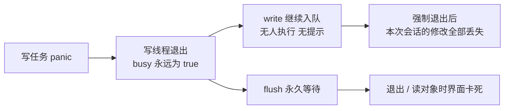
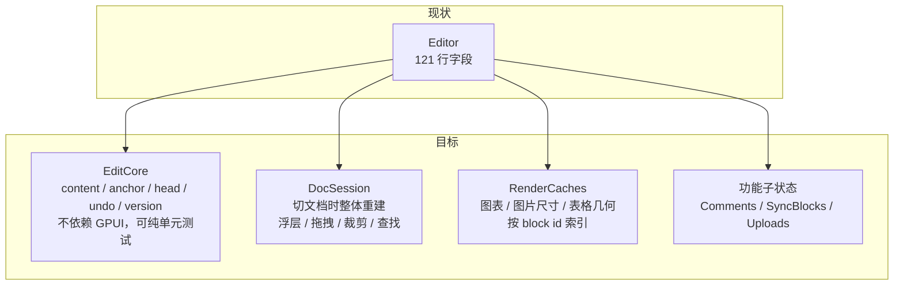
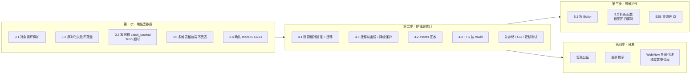

# 石渠 Stonebrook 项目评审（v2.2.0）

> 评审日期：2026-11-11 · 基线提交：`09ef7aa` · 范围：`src/`（约 10.4 万行 Rust）、构建与发布脚本、CI、文档；`vendor/` 只看了补丁清单，未逐行审。
>
> 结论的可信度分两档：**已确认** = 直接从代码读出来的；**待验证** = 从代码推断、需要真机或特定数据复现。每条都标了。

## 1. 总评

这是一个完成度很高的单人项目：功能面极宽（块编辑器 + 画板 + 草图 + 电子表格 + 多维表格），而核心层的设计相当克制——单写线程、`Vec<Arc<Block>>` 快照撤销、未知块原样保留、损坏文档先备份再打开，这些都是「不丢数据」优先的正确取舍。测试手段也比同体量项目扎实（编辑内核随机测试、格式往返夹具、截图回归、脚本驱动 E2E）。

主要风险集中在三处：

1. **嵌入对象的数据安全没有达到文档的水准**。文档有「损坏保护」，画板 / 草图 / 表格 / 多维表格没有，且存在几条静默丢数据的路径（3.1、3.2、3.3）。
2. **资源路径以绝对路径落盘**，由此派生出备份恢复时的字符串替换、电子表格图片无法迁移、数据目录不能移动等一串问题（4.1）。
3. **界面层的规模失控**：`Editor` 121 行字段、26 个函数超过 300 行、最长的 `render_popover` 736 行。现在靠作者本人的记忆维持，继续加功能的边际成本会越来越高（5.1）。

| 维度 | 评价 |
|---|---|
| 存储与一致性 | 文档路径优秀；对象路径有缺口；写线程缺少故障处理 |
| 架构分层 | 模型 / 存储 / 渲染服务清晰；界面层状态高度集中 |
| 安全 | 本地应用攻击面小，CSP 思路正确；WebView 导航与数据隔离需补 |
| 性能 | 虚拟列表、按 key 合并写入到位；FTS 更新与界面线程 `flush` 有隐患 |
| 测试 | 编辑内核强；电子表格、工作区、存储迁移弱；E2E 未进 CI |
| 工程化 | fmt / clippy 零警告 / 锁版本工具链齐全；发布未公证、无更新通道 |
| 文档 | README 与功能清单详尽；有几处与代码不一致 |

## 2. 做得好的地方（建议保持）

- **单写者 + 只读连接**（`src/store.rs`）：写顺序可推理，WAL 下读写不互斥；带 key 的任务合并避免了连续输入时的写放大。
- **损坏文档保护**（`store.rs:376`、`model.rs:1015`）：解析失败先落 `recovery/`，备份失败就拒绝打开，杜绝「空内容覆盖原数据」。
- **未知块降级**（`model.rs:965-983`）：旧版本读到新块类型时保留原始 JSON 原样写回。
- **备份恢复两阶段**（`src/backup.rs`）：`VACUUM INTO` 取一致快照、`enclosed_name` 防路径穿越、`integrity_check` 校验、旧数据移到 `recovery/pre-restore-*` 而不是删除、换入失败回滚。
- **`dev` feature 隔离**：测试脚本、压测入口不进正式包，`check.sh` 里专门验证 `--no-default-features` 能编译。
- **panic 落盘**（`main.rs:267`）：双击启动的 `.app` 没有 stderr，这一步很实用。
- **vendor 补丁有清单且源码内有统一标记**（`[stonebrook patch]`），升级步骤写明。
- **零 `TODO/FIXME`、非测试代码基本没有裸 `panic!`**，`unsafe` 只出现在 6 个文件、集中在系统接口边界（`webview.rs` 26 处、`media.rs` 11 处）。

## 3. 需要优先处理的问题（P0：可能丢数据或崩溃）

### 3.1 嵌入对象解码失败时打开空白编辑器，之后的修改静默丢失 —— 已确认

```
src/board/view.rs:475    objects::board(&obj_id)...unwrap_or_else(|| BoardDoc::new(false))
src/sketch/view.rs:484   objects::sketch(&obj_id)...unwrap_or_default()
src/sheet/mod.rs:383     objects::sheet(&obj_id).unwrap_or_else(|| ...new_sheet())
src/base/editor.rs:325   objects::base(&obj_id).unwrap_or_else(|| ...Base::new_default(..))
```

`objects::get` 在解码失败（数据损坏、来自更新版本的格式、字段类型变了）时返回 `None`，四个编辑器都退回到一份空白默认值。用户看到的是「我的画板空了」，没有任何提示。

更隐蔽的是后续：`objects::update`（`objects.rs:251`）第一步是 `o.get_mut(id)?`，对象不在缓存里就直接返回，不落盘。所以用户在这张空白画板上继续画的内容**一笔都不会保存**，也不报错。唯一的好消息是原始字节没有被覆盖。

建议：

- `objects::get` 返回 `Result<ObjData, LoadError>`，区分「不存在」与「解码失败」；
- 解码失败时与文档一致：原始字节备份到 `recovery/`，编辑器显示只读的损坏提示页，禁止编辑；
- `update` 对未缓存的 id 不应静默返回，至少 `debug_assert!` + 写入错误通道。

### 3.2 序列化失败时把空内容写进数据库 —— 已确认（触发概率低，后果严重）

`unwrap_or_default()` 用在落盘路径上共 20 处左右，典型的：

```
src/objects.rs:123,126,129   serde_json::to_vec(..).unwrap_or_default()   → 写入 0 字节的对象
src/model.rs:1059            serde_json::to_string(&raw).unwrap_or_default() → 文档 content 写成空串
src/base/db.rs:30,38,49,58   INSERT OR REPLACE ... to_string(..).unwrap_or_default()
src/sheet/ext.rs:586、sheet/objs.rs:924
```

`serde_json` 对这些类型几乎不会失败（常见诱因是非字符串键的 map），所以现实中很难撞上；但一旦撞上，结果是用「空」覆盖用户数据，正好绕过 3.1 之外所有保护。这类位置应当「失败就不写，并上报」：编码闭包返回 `Result`，写线程把错误放进已有的 `Store::error` 通道。

### 3.3 写线程没有故障隔离：一次 panic 之后所有保存静默失效，退出时卡死 —— 已确认

`Writer::run`（`store.rs:190-209`）直接调用 `job(&mut conn)`。任务里包含序列化闭包（`save_object_with` 的 `encode`、`DocContent::to_json`），任何一处 panic 都会让写线程退出，此时：

- `q.busy` 停在 `true`，`flush()`（`store.rs:263`）永远等不到，**退出 / 关窗口时界面线程卡死**；
- 之后的 `write()` 继续往队列里塞任务，没人执行，也没有任何提示——用户以为在保存，实际全部停留在内存；
- `store.rs` 之外还有 34 处 `flush()` 调用，加上 `load_object`、`comments`、`load_sync` 等读路径内部的 `flush`，同样会卡死。



建议：

- 每个任务用 `std::panic::catch_unwind` 包住，panic 记为写入错误，线程继续；
- `busy` 用 RAII 守卫复位；
- `flush` 加超时（比如 10 秒）并返回是否完成，退出路径超时后提示用户而不是无限等待；
- 写线程若确实退出，置一个 `dead` 标志，`write()` 立即报错。

### 3.4 `WKPreferences.inactiveSchedulingPolicy` 没有系统版本守卫 —— 待验证（macOS 12 / 13）

`src/webview.rs:79` 无条件调用 `prefs.setInactiveSchedulingPolicy(..)`。这个接口是 macOS 14 才有的，全仓库没有 `respondsToSelector` / 系统版本判断。README 与 `Info.plist` 都声明支持 macOS 12+，在 12 / 13 上第一次创建 WebView（渲染第一个公式、HTML 块、导出 PDF）时会向对象发送不认识的 selector，预期是直接崩溃。

建议：调用前判断 `respondsToSelector`，或把最低版本改成 14.0（README、`build.sh` 里的 `LSMinimumSystemVersion`、官网同步改）。同时在 CI 里设置 `MACOSX_DEPLOYMENT_TARGET`，让链接期就能暴露这类问题。请先在一台 macOS 13 机器上确认。

### 3.5 多维表格装载时静默丢弃解析失败的行，并可能把表从元数据里抹掉 —— 已确认

`src/base/db.rs`：

- `rows()`（121 行）用两层 `filter_map(.ok())`，解析不了的字段 / 记录 / 视图直接消失，无日志；
- `load_inner`（153 行）`meta.tables.retain(..)`：某张表的 `base_tables` 行读不出来，就把它从 `meta.tables` 里删掉。之后任何一次 `touch` 都会把缩水后的元数据写回 `objects` 表，这张表的字段和记录还在库里，但再也没有入口能看到。

建议：解析失败计数并上报；`retain` 改为保留并显示「无法读取的数据表」占位，不要改动持久化的元数据。

## 4. 重要问题（P1）

### 4.1 资源以绝对路径存进文档 —— 已确认，建议作为下一个大版本的头号重构

图片、附件、网页卡片封面都以 `/Users/<名字>/Stonebrook/assets/xxx.png` 的形式写进文档 JSON、画板 JSON、`link_cards` 表和电子表格二进制。后果：

- 备份恢复只能靠 `rewrite_paths`（`backup.rs:205`）做全库字符串替换，电子表格是长度前缀二进制改不了（README 已坦承「单元格图片需路径一致」）；
- 用户改 `STONEBROOK_DATA_DIR`、改用户名、把 `~/Stonebrook` 拷到另一台机器直接用（README 说「复制即备份」）时，所有图片失效，没有任何修复入口；
- 替换是按原始文本匹配的，路径里若有需要 JSON 转义的字符会漏改。

建议方案：落盘只存相对标识（如 `asset:ab12cd.png`），读取时由一个 `assets::resolve()` 拼出绝对路径；用一次 `MIGRATIONS` 第 3 条 + 启动时的文档 JSON 迁移把存量数据改掉。完成后 `rewrite_paths` 和 manifest 里的 `assets_dir` 都可以删除。

### 4.2 `assets/` 里的文件只增不减 —— 已确认

`objects::gc` 只回收 `objects` 表。全仓库没有任何删除 `assets/` 下文件的代码（图片、视频、附件、`card-*.png`、`cover-*.png`、`icon-*.png`）。删掉一个 2GB 的视频块之后，文件永远留在磁盘上。`cache/` 目录（公式、HTML 快照、波形）同样没有上限。

建议：复用现有 GC 的思路——扫描全部文档 / 对象 / 模板 / 同步块里出现的资源名，回收 7 天以上未被引用的文件；`cache/` 按总大小做 LRU。做完 4.1 之后扫描会简单很多。

### 4.3 全文索引每次保存都全表扫描 —— 已确认

`docs_fts` 把 `id` 声明为 `UNINDEXED`，而 `Store::save` 每次执行 `DELETE FROM docs_fts WHERE id = ?1`（`store.rs:419`）。FTS5 对非索引列的条件只能逐行扫描，也就是每停手 0.6 秒就把整个索引的内容读一遍。文档少时无感，几千篇长文档后会变成持续的磁盘读。

建议：给 `docs` 加整数主键（或直接用隐含的 `rowid`），FTS 用 `content=''` 的无内容表或外部内容表，按 `rowid` 删改；顺带可以用触发器维护，省掉手写的三处同步代码（`create` / `save` / `purge`）。

### 4.4 界面线程上的阻塞点 —— 已确认

- 大量读路径先 `store.flush()` 再查询（`store.rs` 内的 `load_object` / `comments` / `load_sync` 等，外加 34 处直接调用）。写队列里若正好排着一个大画板的序列化或 10 万行多维表格的批量写入，界面会跟着卡。
- 后台线程与界面线程共用同一条「只读」连接的 `Mutex`：启动时的 `objects::gc`（`reference_texts` 把所有文档 JSON 一次读进内存）和备份导出的 `VACUUM INTO`（`backup.rs:70`）执行期间，界面线程任何一次查询都要等。
- `base::db::history`（`db.rs:101`）每次打开记录历史都先 `write_sync` 做一次过期清理。
- `request_file`（`webview.rs:612`）每帧先 `fs::metadata` 再查缓存。

建议：后台任务各自开连接；`flush` 只在确实依赖「刚写入」的地方使用，其余改为读内存缓存；历史清理挪到启动时的后台任务。

### 4.5 所谓「只读连接」实际可写 —— 已确认

`open_conn`（`store.rs:183`）对两条连接用同一套参数。`with_conn` 给出的是 `&mut Connection`，备份时就在它上面执行了 `VACUUM INTO`。「单写者」目前靠约定而非机制保证。建议只读连接加 `PRAGMA query_only=ON`（`VACUUM INTO` 改走专用连接），让违反约定的代码当场报错。

### 4.6 数据库迁移缺少降级保护和迁移前备份 —— 已确认

`migrate`（`store.rs:172`）在 `user_version` 大于 `MIGRATIONS.len()` 时什么都不做，直接用旧代码读写新库。备份恢复倒是做了这个检查（`backup.rs:111`），正常启动反而没有。建议：版本过新时拒绝打开并提示升级；每次真正执行迁移前把数据库复制到 `recovery/pre-migrate-v<N>.db`。目前只有 2 条迁移，正是补这个机制成本最低的时候。

同理，文档 JSON 里的 `version` 字段读进来后没有被使用（`model.rs:1015`）。未知的**块类型**能保留，但新版本给已有块加的**新字段**会被旧版本静默丢掉。建议块结构加 `#[serde(flatten)] extra: Map<String, Value>` 兜住未知字段。

### 4.7 WebView 的隔离还差几步 —— 已确认（风险中低）

现有做法（HTML 块套 CSP、默认关脚本、联网开关）方向正确，缺口是：

- **没有导航代理**。CSP 的 `default-src 'none'` 管不了顶层跳转：`<meta http-equiv="refresh">`（无脚本也生效）或 `location.href=` 可以让页面跳到任意网址，绕过「联网」开关，也能把页面自身内容带出去。建议实现 `WKNavigationDelegate`，初次加载之后的导航一律取消（交互模式下改为交给系统浏览器）。
- **共用持久化数据仓库**。`snapshot_url`（`webview.rs:292`）在渲染公式的同一个 `js_view` 里加载任意外部网页，Cookie / localStorage 落在应用的默认存储里。建议抓取用的 WebView 单独创建，配 `WKWebsiteDataStore.nonPersistentDataStore()`。
- **读权限给得偏大**。上传的 HTML 文件在联网模式下以 `allowingReadAccessToURL(父目录)` 加载（`webview.rs:432`），视频播放页取缓存目录与 `assets` 的共同上级（即整个数据目录，含 `stonebrook.db`）。建议每个 HTML 附件放独立子目录；播放页直接生成到视频旁边。
- **粘贴网页时自动下载远程图片**（`editor/urlpaste.rs:199`）受联网开关控制，这点是好的；但请求没有限制目标地址，粘贴内容可以让应用去访问内网地址。影响有限，可加一条「只允许 http(s) 且非回环 / 私网地址」的过滤。

### 4.8 `osascript` 通知的两套实现，其中一套转义不完整 —— 已确认

`base/editor.rs:1511` 的 `notify_system` 正确转义了 `\` 和 `"`；`sheet/objs.rs:911` 只把 `"` 换成 `'`，备注以 `\` 结尾时脚本会语法错误。备注内容可能来自导入的 xlsx。两处合并成一个函数即可，更彻底的做法是改用 `UNUserNotificationCenter`，不再拼脚本。

### 4.9 启动失败与恢复结果对用户不可见 —— 已确认

- `Store::open` 失败时只 `eprintln` 然后 `exit(1)`（`main.rs:306`），双击启动的用户看到的是图标跳一下就没了。应弹一个原生对话框，并提供「打开数据目录」。
- `backup::apply_pending` 的成功 / 失败信息只打到 stderr（`main.rs:303`）。失败时 `restore-pending/` 不会被清掉，之后每次启动都会重试并再次静默失败。建议把结果带进 `Workspace` 用 toast 显示，失败时把待恢复目录改名为 `restore-failed-*`。
- `rewrite_paths` 失败也只打日志（`backup.rs:195`），用户看到的是恢复「成功」但图片全挂。

### 4.10 对象缓存没有淘汰 —— 已确认

`objects::OBJS`（`objects.rs:76`）是只进不出的 `HashMap`（`remove` 只用于临时画板）。打开过的每个画板、表格、10 万行多维表格都会留在内存里直到退出。另有十几个 `thread_local!` 缓存（`CARDS`、`SNAPS`、`LISTINGS` 等）同样没有上限。建议统一成带容量的 LRU，脏对象不淘汰。

## 5. 架构与重构建议

### 5.1 拆解巨型编辑器结构体

| 结构体 | 字段行数 | 位置 |
|---|---|---|
| `Editor` | 121 | `src/editor/mod.rs:378` |
| `BoardEditor` | 99 | `src/board/view.rs:365` |
| `SheetEditor` | 85 | `src/sheet/mod.rs:242` |
| `BaseEditor` | 77 | `src/base/editor.rs:237` |
| `Workspace` / `SketchEditor` | 57 | |

`Editor` 把文档内核（内容、选区、撤销）、十几种浮层状态、图片裁剪、表格拖拽、图表缓存、评论、同步块、附件上传全放在一层，`Editor::load` 里要手写二十多行逐个清零——漏一个就是切文档后残留状态的 bug。`Popups` 已经是往正确方向迈的一步，建议继续：



- **`EditCore`**：纯数据 + 操作，不碰 `Context` / `Window`。现在的随机测试要起 `TestAppContext`，拆出来后可以跑得更快、更多。
- **`DocSession`**：所有「切文档就该清空」的状态放一个结构体，`load` 里一句 `self.session = DocSession::default()` 取代逐字段清零。
- 四个全屏编辑器的撤销、保存、toast、浮层管理各写了一遍，可以抽一个 `EmbedEditor` trait（`save` / `undo` / `redo` / `close` / `title`）。

### 5.2 拆分超长渲染函数

3354 个函数里有 97 个超过 150 行、26 个超过 300 行。最长的几个：

| 行数 | 函数 |
|---|---|
| 736 | `board/selbar.rs` `render_popover` |
| 621 | `base/grid.rs` `render_grid` |
| 604 | `autotest.rs` `exec` |
| 562 | `sheet/data.rs` `data_dlg_body` |
| 542 | `base/gantt.rs` `render_gantt` |
| 497 | `editor/toolbar_render.rs` `render_toolbar` |
| 465 | `editor/render.rs` `render_block` |
| 450 | `sheet/commands.rs` `run` |

加上 `max_width = 160`，单个函数的信息量非常大。建议按「一个 `match` 分支一个函数」机械拆分——项目已有截图回归工具（`tools/harness/compare.py`），正好用来保证这类纯重构不改外观。`sheet/commands.rs::run` 和 `autotest.rs::exec` 这类字符串命令分发，可以改成 `命令名 → 函数` 的静态表，顺带能自动生成命令列表文档。

`Cargo.toml` 里全局放开了 `too_many_arguments`，源码里还有 36 处局部 `#[allow]`，这是函数职责过多的信号，拆分时把相关参数收成结构体。

### 5.3 画板与草图是两套白板引擎

`src/board/`（约 1.8 万行）与 `src/sketch/`（约 1 万行）各有模型、几何、命中测试、交互状态机、属性面板、SVG 导出。草图为了对 Excalidraw 格式保真而独立建模可以理解，但几何（`canvas/geom.rs` vs `sketch/geom.rs`）、手绘渲染、选择框 / 缩放手柄 / 对齐吸附这些与格式无关的部分值得合并到 `canvas/`。建议先合并最底层的几何与命中测试，交互层视收益再定。

### 5.4 写队列的「按 key 合并」会改变相对顺序 —— 已确认（目前是潜在问题）

`Store::write`（`store.rs:246`）发现同 key 任务时**原地替换**队列里靠前的那个。于是「保存 A₁ → 无 key 任务 B → 保存 A₂」的实际执行顺序是 A₂、B，与模块注释里「顺序与提交顺序一致」不符。现有调用点没发现真正依赖这个顺序的组合，但它是个容易踩的坑（例如将来出现「先 `set_kv` 再对同一 key `add_kv_int`」）。建议改成「删除旧任务、新任务追加到队尾」，或在注释里明确写出这个例外。

### 5.5 错误处理统一

- `Store::rows` / `row` 出错返回空集合 + `eprintln`（`store.rs:276-294`）。对调用方来说「查询失败」和「没有数据」无法区分——文档列表读失败时侧边栏会显示成空的，容易让用户以为数据没了。读路径也应该进 `error` 通道。
- 全仓库 18 处 `eprintln!`，正式包里没人能看到。建议引入一个最小的日志落盘（与 `panic.log` 同目录的 `stonebrook.log`，按大小滚动），并在「关于」或设置里给一个「打开日志目录」。
- `settings.rs` 里 `AUTHOR.lock().unwrap()` 与 `store.rs` 里统一的 `unwrap_or_else(|e| e.into_inner())` 风格不一致。

### 5.6 小项

- `objects::create(kind: &str, ..)` 对未知种类按画板处理，`default_data(ObjKind::Base)` 返回的也是画板（`objects.rs:148,161`）。入参改成 `ObjKind`，让编译器把关。
- `model.rs:923` `Block::fixup` 里有一个空的 `match { _ => {} }`。
- `main.rs:339` 每 200ms 轮询一次 `flush_dirty`，空闲时也一直唤醒；`webview.rs` 的 `acquire` / `eval` / `snapshot` 用 10–20ms 轮询等待回调。前者可改成「标脏时安排一次定时器」，后者换成 oneshot channel。
- `linkcard.rs` 的 `absolutize`、`domain` 是手写的 URL 处理，建议直接用 `url` crate（已经在依赖树里，不增加编译成本）。
- `Cargo.toml` 给 `image` 只开了 `png / tiff / jpeg`，但 `linkcard::download` 要解码 ico / gif / webp；现在能工作是因为 GPUI 依赖的 `image` 开了默认特性、被 Cargo 合并了。建议显式声明用到的格式，避免升级 GPUI 后悄悄失效。
- 全局搜索只索引文档块的文字（`Block::plain_text`），嵌入的画板 / 表格 / 多维表格内容搜不到。`objects::to_markdown` 已经能导出文字，可以在对象保存时顺带写进一张 `objects_fts`。
- i18n：`tr()` 调用 272 处，译表 492 条，但画板 / 电子表格 / 多维表格三个全屏编辑器完全未翻译（`i18n.rs` 文件头已说明）。英文 README 应当注明这一点。另外 `i18n::tests::falls_back_to_chinese` 会修改进程级开关，和其他并行测试存在竞争。

## 6. 测试与质量保障

现状：约 200 个测试（含编辑内核随机测试，默认强度） + 块格式夹具 + 截图回归 + 脚本 E2E。下表的测试数按 `#[test]` 标注统计，分布很不均匀：

| 模块 | 代码行（约） | 测试数 | 评价 |
|---|---|---|---|
| `base/` | 2.0 万 | 54 | 模型 / 公式覆盖好 |
| `editor/` | 1.8 万 | 随机测试 + 8 | 内核强，渲染靠截图 |
| `board/` + `diagram/` | 2.3 万 | 约 55 | 解析与布局有测 |
| `sheet/` | 1.4 万 | 3 | **明显薄弱**，只有函数目录 |
| `workspace*` | 0.45 万 | 6 | 只有演示与图谱有测 |
| `store.rs` + `backup.rs` + `objects.rs` | 0.15 万 | 7 | 缺迁移、GC、写线程故障的测试 |

建议补的测试，按性价比排序：

1. **存储故障注入**：写任务 panic 后 `flush` 不死锁、错误可见（配合 3.3）；对象字节被截断后打开不丢数据（配合 3.1）。
2. **迁移测试**：仓库里放一份 v1 结构的小数据库夹具，断言能升级到最新且内容不变。以后每加一条迁移就加一份。
3. **`objects::gc`**：被文档 / 回收站 / 模板 / 同步块引用的对象不被回收；未引用但不足 7 天的不被回收。这是会删用户数据的代码，现在没有任何测试。
4. **电子表格**：把 `sheet/script.rs` 的脚本驱动接进单元测试，至少覆盖粘贴、填充、排序、撤销这些经过 `begin_batch` 补丁的路径。
5. **E2E 进 CI**：`tools/harness/examples/` 有 7 份脚本，GitHub 的 macOS runner 有图形会话，可以先加一个「跑完不崩溃」的冒烟任务，再考虑基线截图比对。
6. 随机测试目前只覆盖文档编辑器；多维表格的 `Change` 列表撤销模型同样适合「随机操作 → 撤销到底 → 等于初始」这个套路。

## 7. 构建、发布与仓库

- **发布未公证**。ad-hoc 签名在新系统上需要用户到系统设置里手动放行，而且每次更新代码身份都会变，系统权限会重置。面向普通用户分发的话，Developer ID 签名 + 公证是绕不过去的一步。
- **没有更新通道**。用户不知道有新版本。最小方案：启动时（受联网开关控制）查一次 GitHub Releases 的最新 tag，在「关于」里提示。
- `release.yml`：
  - 用 `scripts/build.sh --fast` 构建，跳过全部检查，且不依赖 CI 任务通过——打 tag 时即使 `main` 是红的也会发版。建议 `release` 任务 `needs` 一次 `check.sh`。
  - `dtolnay/rust-toolchain@stable` 与 `rust-toolchain.toml` 固定的 1.97.1 重复，实际生效的是后者；删掉前者或改成与 `ci.yml` 相同的写法。
  - 建议随安装包发布 SHA-256 校验文件。
- `scripts/build.sh` 的 `cargo build --release` 没带 `--locked`，而 `check.sh` 带了。
- 第三方 Action 用的是浮动标签（`@v2`、`@v4`）。发布流程有 `contents: write` 权限，建议固定到提交哈希，并加 Dependabot 维护。
- 没有依赖审计。843 个锁定包里有不少重复主版本（`windows-sys` ×4、`phf` ×4、`syn` ×3 等，多数来自 GPUI）。建议 CI 加 `cargo deny check advisories licenses`。
- **仓库体积**：`docs/stonebrook-promo-v2.2.mp4` 19MB 直接进了 git，`.git` 已 40MB，每换一版宣传片就再涨一截。建议放到 Release 附件或对象存储，仓库里只留封面图。
- **`vendor/` 是整份源码拷贝**（GPUI 184 个文件 + IronCalc 237 个文件，11MB）。补丁清单维护得很好，但 diff 淹没在整份源码里，升级时只能靠 `grep`。建议改为「fork 仓库 + 分支」或「上游 tarball + `patches/*.patch`」，让补丁本身可以被审阅。IronCalc 的三处补丁（`ext`、批量撤销、函数目录导出）通用性强，值得尝试提交上游。
- 缺少 `CHANGELOG.md`、`CONTRIBUTING.md`、`SECURITY.md` 和 issue 模板。提交历史只有 14 条（单次提交即一个大版本），外部贡献者很难定位某个行为是何时引入的；今后建议按功能粒度提交。

## 8. 文档与代码不一致之处

| 位置 | 文档写的 | 实际 |
|---|---|---|
| README「快速开始」、`build.sh` 环境检查 | Rust 1.85+ | `rust-toolchain.toml` 固定 1.97.1，rustup 会自动切换；非 rustup 安装的旧版本能否编译未验证 |
| README「源码导览」 | 约 8.6 万行 | `src/` 现为 10.4 万行 |
| README、`docs/index.html` 多处 | 仓库 `davidzhanghui/stone-book` | 本地 remote 是 `stone-brook`。两个地址当前指向同一提交（应是改过名、靠 GitHub 重定向），但 `github.io/stone-book/` 这类 Pages 地址不会跟随重定向，请核对官网链接是否仍然可用 |
| README 架构图「全屏编辑器」 | 画板 / 电子表格 / 多维表格 | 少了草图 |
| README「数据与可靠性 · 损坏保护」 | 读起来像覆盖所有数据 | 只覆盖文档，不含嵌入对象（见 3.1） |
| README、`Info.plist` | macOS 12+ | 见 3.4，可能实际要求 14+ |
| `store.rs` 模块注释 | 「界面线程用另一条只读连接」「顺序与提交顺序一致」 | 见 4.5、5.4 |

另外提醒一点：`wrangler.toml` 把整个 `docs/` 作为静态站点发布，所以本文件以及 `FEATURES.md`、`VENDOR_PATCHES.md` 都会出现在官网上。如果不希望评审文档公开，请把它移出 `docs/` 或在部署配置里排除。

## 9. 建议的推进顺序



第一步的五项都是局部改动，互不依赖，建议作为 2.2.x 的补丁版本尽快发出。第二步里 4.1 涉及存量数据迁移，应当和 4.6（迁移前自动备份）放在同一个版本里做，这样迁移本身也受保护。第三步是纯重构，依赖截图回归工具保证外观不变，可以穿插进行。

## 10. 本次评审的验证情况

| 检查 | 结果 |
|---|---|
| `cargo fmt --check` | 通过 |
| `cargo clippy --all-targets --locked -- -D warnings` | 通过，零警告（依赖 `block 0.1.6`、`proc-macro-error2 2.0.1` 有未来不兼容提示，来自上游） |
| `cargo test --locked` | 通过：200 个通过，0 失败，2 个忽略（`base::tests::perf_baseline`、`perf_incremental` 两个性能基线） |

没有做的事：

- 没有启动应用做真机操作，所有「待验证」条目都需要实际复现；
- 没有在 macOS 12 / 13 上验证 3.4；
- 没有逐行审阅 `vendor/` 里的补丁实现，也没有跑 `check.sh` 里 vendored GPUI 的排版测试和 `--no-default-features` 编译；
- 没有跑依赖漏洞审计（`cargo audit` / `cargo deny`）；
- 界面层（各 `*_render.rs`、`view.rs`、`panels.rs`）只做了结构与规模层面的统计，没有逐个函数读交互逻辑，那里的行为缺陷本文基本没有覆盖。

## 11. 整改记录（2026-11-11）

评审结论逐条对照代码复核，除下面注明的一处外均属实。本轮完成第一步（P0）全部内容，以及第二步中局部可完成的部分。

| 条目 | 状态 | 做法 |
|---|---|---|
| 3.1 对象解码失败打开空白编辑器 | ✅ | `objects::load` 返回 `Result<_, LoadError>`，区分「不存在 / 读失败 / 损坏」；损坏时原始字节备份到 `recovery/obj-<kind>-<id>-<时间>.bin` 并提示；`Workspace::open_embed` 拒绝打开读不出来的对象；`update` 对未缓存 id 进错误通道，不再静默丢弃 |
| 3.2 序列化失败写入空内容 | ✅ | `save_object_with` 的编码闭包返回 `Result`，空字节也拒绝；文档 / 模板 / 同步块 / 多维表格行改用可失败的序列化，失败即放弃整个事务并上报；电子表格扩展数据序列化失败时保留原数据 |
| 3.3 写线程无故障隔离 | ✅ | 每个任务 `catch_unwind`；`dead` 标志 + Drop 守卫；`flush` 默认 10 秒超时并返回是否完成 |
| 3.4 `setInactiveSchedulingPolicy` 无版本守卫 | ✅ | 调用前 `respondsToSelector`（仍需在 macOS 12 / 13 真机确认其余接口） |
| 3.5 多维表格装载丢表 | ✅ | 读不出来的数据表记在 `Base::unreadable`，`meta_bytes` 落盘时补回；跳过的行计数并提示 |
| 4.3 FTS 全表扫描 | ✅ | 迁移 3：`docs.fts` ↔ `docs_fts.rowid`，按 rowid 删改（不用 docs 隐含 rowid，VACUUM 可能重排） |
| 4.4 界面线程阻塞点 | 部分 | 备份 `VACUUM INTO`、GC 引用扫描改用独立连接；多维表格历史清理挪到启动后台任务。`request_file` 每帧 `metadata` 未改 |
| 4.5 只读连接可写 | ✅ | 读连接 `PRAGMA query_only=ON` |
| 4.6 迁移降级保护 / 迁移前备份 | ✅ | 库版本过新拒绝打开；迁移前 `VACUUM INTO recovery/pre-migrate-v<N>-<时间>.db`；块上的未知字段读入 `Block::extra`、写回时合并 |
| 4.8 osascript 转义 | ✅ | 合并为 `sysui::notify` + `sysui::quote` |
| 4.9 启动失败 / 恢复结果不可见 | ✅ | 打不开库时弹原生对话框（可打开数据目录）；恢复结果与图片路径改写失败进 toast；失败时待恢复目录改名 `restore-failed-*` |
| 5.4 合并改变相对顺序 | ✅ | 撤掉旧任务、新任务追加到队尾 |
| 5.5 读失败与无数据不分 | ✅ | `rows` / `row` 读失败进错误通道 |
| 5.6 小项 | 部分 | `objects::create` 入参改 `ObjKind`、`default_data(Base)` 修正；`image` 显式声明 gif / webp / ico / bmp；i18n 测试不再改进程级开关。「`Block::fixup` 空 match」与代码不符（是带多个分支的 `match` 的兜底分支），未改 |
| 7 发布流程 | 部分 | 发版前先跑 `check.sh`；去掉 `dtolnay/rust-toolchain`；Action 固定提交哈希 + Dependabot；发布 `SHA256SUMS.txt`；`build.sh` 加 `--locked` |
| 8 文档不一致 | 部分 | README 行数、架构图草图、损坏保护范围、写入模型、迁移说明、英文版翻译覆盖范围已更新 |
| 新发现 | ✅ | `reference_texts` 读失败时返回空列表，会让 GC 把 7 天以上的对象全部删掉；改为读失败则本次不回收 |

新增测试 10 个（写任务 panic 后不死锁、编码失败不覆盖、合并顺序、读连接拒写、迁移备份与降级拒绝、FTS 保存 / 删除、对象损坏备份、GC 保留规则、块未知字段往返、多维表格不丢表）。`scripts/check.sh` 全部通过；迁移 3 已在真实数据库副本上验证（`integrity_check` 通过，按 rowid 删除走索引）。

第一轮未做：4.1、4.2、4.7、4.10、5.1–5.3、更新通道，见 11.2。仍未做：第 6 节其余测试（电子表格脚本测试、E2E 进 CI）、签名公证（作者决定暂不做）、`vendor/` 改补丁形式、仓库里的宣传视频迁出。

### 11.2 第二轮（同日）

前提（作者确认）：仍在自测阶段，不需要迁移旧数据，也不考虑兼容旧库；签名公证暂不做。

| 条目 | 状态 | 做法 |
|---|---|---|
| 4.1 资源相对路径 | ✅ | 新模块 `assets`：内存里仍是绝对路径，**持久化边界**统一转换——写库前把 JSON 里「整串以资源目录开头」的字符串换成 `stonebrook://asset/<相对路径>`，读出时反过来。覆盖文档块、模板、同步块、画板 / 草图 / 多维表格对象、电子表格扩展数据、网页卡片。备份格式升到 2，去掉恢复时的路径改写（`rewrite_paths` 删除）；数据目录整体搬家即可用 |
| 4.2 assets 回收与 cache 上限 | ✅ | 启动后台任务：扫描所有表（文档、模板、同步块、对象、多维表格行、网页卡片、键值）收集被引用的资源名，删除 7 天以上没被引用的 `assets/` 顶层条目（引用扫描失败则本次不删）；`cache/` 超过 512MB 按修改时间淘汰到 80%。导入文件时把 mtime 重置为当前时间（APFS clonefile 会保留源文件 mtime，否则新导入的旧文件会被立即当成过期） |
| 4.7 WebView 隔离 | ✅ | 所有 WKWebView 改用 `nonPersistentDataStore`；`define_class!` 实现 `WKNavigationDelegate`：主框架只允许 file / about / data / blob 等本地 scheme，点击的 http(s) / mailto 链接交给系统打开；只有抓网页快照的 WebView 允许远程。视频预览页改为每个视频一个 `cache/webm-<hash>/` 目录（硬链接视频文件），不再把整个父目录开放给页面。网页卡片：DNS 解析后拒绝回环 / 私网 / 链路本地 / CGNAT / 组播 / ULA 等地址，重定向手动逐跳检查（最多 5 跳） |
| 4.10 缓存 LRU | ✅ | 新增 `lru::Lru`（`get(&self)` 也更新访问时间，支持「钉住」规则）。对象缓存容量 32，有未保存修改或仍被编辑器持有（`Arc`/`Rc` 引用计数 > 1）的不淘汰；网页卡片、网页快照、压缩包列表、缩略图、波形、草图渲染、图标栅格、公式缓存全部改为 LRU |
| 5.1 `Editor` 拆分 | ✅ | 拆成 `EditCore`（选区、输入法、撤销 / 重做）、`DocSession`（浮层、预览、拖动、阅读模式、聚焦根等指向当前文档块的界面状态）、`RenderCaches`（编号、统计、图片尺寸、表格几何、绘图缓存、折叠掩码…）、`ToolbarState`。`Editor::load` 换文档时整体重置 `core` / `sess`，不再逐字段清（顺带修掉了旧代码漏清 `html_live` / `video_full` / `file_full` / 拖动状态等字段的问题）。四个全屏编辑器实现 `embed::EmbedEditor`，工作区用一个泛型 `mount_embed` 打开 |
| 5.2 长函数与字符串分发 | 部分 | 字符串分发全部改成静态表：电子表格 `run`（107 条）、自动化测试 `exec`（63 条）、多维表格测试命令 `test`（50 条，含守卫）。公式 `call`（418 行）按类别拆成 数学逻辑 → 文本 → 日期 → 列表其他 四个函数链式兜底，取参宏用 `$d` 技巧共享。其余长函数用脚本把大的 match 分支 / builder 链子块抽成独立方法（共 35 个；捕获的局部变量按编译器推断出的类型传参，逐个编译验证，不通过的回滚），`render_popover` 736→约 60 行，`render_widget`、`render_bar`、`render_block`、`render_gantt`、`render_table`、`mouse_move`、`field_editor`、`more_shape_cmds` 等都缩短了。**剩余 18 个函数仍超过 300 行**（最长 `data_dlg_body` 561、`render_grid` 546、`render_toolbar` 496），多是 GPUI 声明式布局链，自动抽取会碰到 `cx` 借用冲突或闭包捕获，需要逐个手工拆；`icon_body`（221 个图标的 SVG 数据）、`syntax_for`（语言关键字表）属数据表，不建议拆。`clippy::too_many_arguments` 在 Cargo.toml 里是全局放行的，抽出的方法里有 9 个参数超过 7 个 |
| 5.3 画板 / 草图几何合并 | ✅ | 新增 `canvas::math`：对 `f32` / `f64` 两种点类型泛型实现点到线段 / 折线距离、多边形内判断、折线中点、8 个缩放手柄、对齐位移、等距分布；画板与草图原来各自的实现（含 `sketch/render.rs` 里第三份 `seg_dist`）改为调用它。元素级命中（依赖各自数据模型）仍留在各自模块 |
| 更新通道 | ✅ | 新模块 `updater`：每天最多一次查 GitHub Releases 最新版本（受「允许联网」开关控制，可在设置里关掉自动更新）；后台下载本机架构的 `.app.zip`，按 `SHA256SUMS.txt` 校验（没有校验文件或不一致都拒绝），`ditto` 解压；「重启并安装」或正常退出时，由脱离进程的脚本等本进程退出后替换 `.app`（旧版本移到 `updates/previous.app`，替换失败放回去）。菜单「检查更新…」、设置「更新」一节、下载完成 toast |

新增测试 8 个（更新：版本比较、产物选择与校验和解析、SHA-256；几何：距离 / 多边形 / 手柄 / 对齐 / 分布；以及第一轮补的 LRU、assets 引用收集与回收、网页卡片地址过滤等）。`scripts/check.sh` 全部通过（fmt、clippy 零警告、223 个单元测试、GPUI 排版测试、正式包配置编译）；端到端脚本（新建文档输入、电子表格命令、多维表格测试命令、画板打开、导出 dump）在临时数据目录跑通。
