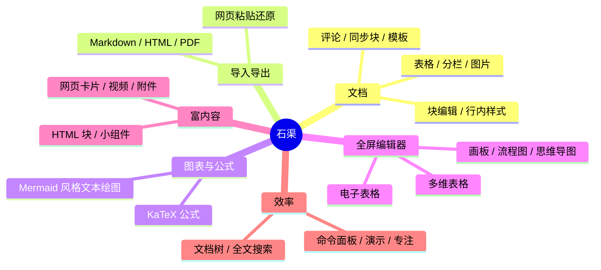

# 石渠 Stonebrook 功能清单

> 版本 2.3.0，仅支持 macOS。交互与界面自成一体。
> 每条功能后面是「怎么用」。**斜杠菜单**指在空行输入 `/` 后选择，支持中文、拼音全拼与首字母（`/bg`、`/biaoge` 都能找到表格）。
> 标 ⚠ 的功能只经过脚本驱动验证，真实鼠标、系统对话框、输入法下的手感还需要真机确认。



## 目录

1. [基础编辑](#1-基础编辑)
2. [表格、分栏与图片](#2-表格分栏与图片)
3. [粘贴、复制与导入导出](#3-粘贴复制与导入导出)
4. [文本绘图](#4-文本绘图)
5. [公式](#5-公式)
6. [画板、流程图与思维导图](#6-画板流程图与思维导图)
7. [电子表格](#7-电子表格)
8. [多维表格](#8-多维表格)
9. [媒体、附件与网页](#9-媒体附件与网页)
10. [评论](#10-评论)
11. [文档小组件](#11-文档小组件)
12. [同步块与模板](#12-同步块与模板)
13. [文档管理与导航](#13-文档管理与导航)
14. [演示、设置与数据安全](#14-演示设置与数据安全)
15. [快捷键速查](#15-快捷键速查)

---

## 1. 基础编辑

| 功能 | 怎么用 |
|---|---|
| 正文与标题 | 行首输入 `# ` ~ `###### ` 变成一至六级标题；或 `⌥⌘0` ~ `⌥⌘4`、斜杠菜单。 |
| 列表 | 行首输入 `1. ` / `- ` / `[] `（或 `⇧⌘7` / `⇧⌘8` / `⇧⌘9`）；`Tab` / `⇧Tab` 调缩进，有序列表按层级显示 `1.` → `a.` → `i.`。 |
| 待办 | 点复选框，或光标在待办上按 `⌘↵`。 |
| 引用 / 高亮块 / 分割线 | 行首 `> `（或 `⇧⌘.`）；斜杠菜单「高亮块」，点左侧图标换表情与底色；输入 `---` 回车。 |
| 代码块 | 输入 ```` ``` ```` 回车（或 `⌥⌘C`）；左上角切换 19 种语言的语法高亮，右上角一键复制；输入 `}` 自动减缩进。 |
| 浮动工具栏 | 选中文字后弹出：文本类型、对齐与缩进、粗体 / 删除线 / 斜体 / 下划线 / 链接 / 行内代码、颜色、清除格式、评论；悬停显示快捷键与 Markdown 写法。 |
| 行内样式 | `⌘B` / `⌘I` / `⌘U` / `⇧⌘X` / `⌘E`；`**粗体**`、`` `代码` ``、`~~删除~~` 输入完自动生效。 |
| 颜色 | 工具栏「A ▾」：7 种文字色、15 种背景色；点「A」直接套用上次的颜色。 |
| 链接 | 选中文字 `⌘K` 输入网址，或选中后直接粘贴网址。 |
| 块菜单 | 悬停块左侧点 `⋮⋮`：转换类型、创建副本、上移 / 下移、缩进和对齐、评论、设为同步块、删除。 |
| 移动块 | 拖住 `⋮⋮` 拖到目标位置；`⌃⌘↑` / `⌃⌘↓` 移动，`⌘D` 复制。 |
| 撤销 / 重做 | `⌘Z` / `⇧⌘Z`，连续输入合并为一步，最多保留 500 步。 |
| 查找 | `⌘F`，`↵` / `⇧↵` 下一个 / 上一个。 |
| 中文 | 系统输入法直接输入，组字下划线与候选框跟随光标 ⚠；`⌥←` / `⌥→` 按中文词语移动，双击选中一个词。 |
| 其他 | 斜杠菜单「今天日期」插入内联日期。 |
| 有序列表编号 | 点编号弹出菜单：继续之前的编号 / 开始新列表 / 修改编号值 / 恢复自动编号。 |
| 双向链接 | 输入 `@` 选一篇文档插入链接，`⌘` + 点击跳过去；右侧大纲下方列出「反向链接」，再往下是「未链接的提及」（正文里写了本文标题却没加链接的文档），悬停点「转为链接」一键补上。 |
| 文档图谱 | 大纲栏底部「文档图谱」或命令面板：节点是文档、连线是文档链接，默认显示当前文档两跳以内的邻居，可切到全部文档；点节点打开。 |
| 折叠 | 有子项的列表项（缩进更深的后续块）和标题左侧出现三角，点它或 `⌘.` 收起 / 展开；收起后在该项末尾回车，新项接在整棵子树后面。折叠状态不进同步块与模板。 |
| 聚焦 | 块菜单「聚焦此项」或 `⌥⌘.`：只显示这一项和它的子项，顶部是面包屑，点祖先逐级返回；`Esc` 退出。 |
| 阅读模式 | `⌥⌘R`、`···` 菜单或命令面板切换，按文档记住；不显示光标、手柄和工具栏，只能选择和复制。 |
| 中文排版 | 换行遵守避头尾：逗号、句号、右括号不出现在行首，左括号、左引号不留在行尾。 |

## 2. 表格、分栏与图片

**表格**

| 功能 | 怎么用 |
|---|---|
| 插入 | 斜杠菜单「表格」，悬停网格选行列数。 |
| 行列手柄 | 光标进入表格后，上方出现列手柄、左侧出现行手柄：点手柄选整列 / 整行，左上角选全表；悬停边界出现「+」插入行列。 |
| 列宽 | 拖动列边线；工具栏「均分列宽」。 |
| 合并 / 拆分 | 拖选多格后合并（内容拼到左上角，不丢字），合并格可拆分。 |
| 工具栏 | 上下插入行、左右插入列、标题行 / 标题列、删除行 / 列 / 表格。 |
| 导航 | `Tab` / `⇧Tab` 切换单元格（最后一格 `Tab` 自动加行），`↑` `↓` 跨行；选中多格按 `⌫` 清空。 |
| 对齐 | 选中单元格里的文字，工具栏设左 / 中 / 右对齐（可多格一起设），表格内还可设顶部 / 居中 / 底部；导出 HTML / PDF 保留。 |

**分栏**：斜杠菜单「分栏」，点击后上方出现「增加一栏 / 减少一栏」，栏内同样支持对齐。

**图片**

| 功能 | 怎么用 |
|---|---|
| 插入 | 斜杠菜单「图片」（选择框只能选图片）、粘贴截图或拖入图片文件；宽度按原图自动取，超过 1200px 按一半显示且不超过正文宽度。 |
| 缩放 | 选中后拖四角手柄（显示实时尺寸）；工具栏 `−` / `+` / 恢复默认大小。 |
| 裁剪 | 工具栏「裁剪」：拖 8 个手柄或拖框移动，`↵` 应用、`Esc` 取消、「还原」回到整图；可撤销。 |
| 查看大图 | 双击图片或工具栏「查看大图」。 |
| 描述与对齐 | 工具栏左 / 中 / 右对齐、编辑描述、评论、删除。 |
| 导出 | HTML / PDF / Markdown 都保留宽度、对齐与裁剪（Markdown 用内联 HTML）。 |

大图在后台线程解码，首次显示不卡界面；解码后的位图缓存超过 256MB 时淘汰最久没用的。

## 3. 粘贴、复制与导入导出

| 功能 | 怎么用 |
|---|---|
| 从网页粘贴 | 复制后 `⌘V`，标题、列表、代码块、表格、高亮块、待办原样还原；网络图片在后台下载到本地（关闭联网时不下载）。 |
| 粘贴 Markdown | 直接 `⌘V` 源码，自动转成块（含 Mermaid 代码块和 `$$` 公式）。 |
| 粘贴网址 | 单独粘贴网址先成为链接，旁边弹出「显示为 链接 / 标题 / 卡片」。 |
| 粘贴截图 | `⌘V` 成为图片块。 |
| 纯文本粘贴 | `⇧⌘V`。 |
| 复制 | `⌘C` 同时写出 HTML + Markdown + 内部格式，粘贴到 Word、Markdown 编辑器都保留格式。 |
| 导入 Markdown | `⌘O` 选择 `.md`（可多选），每个文件成为一篇文档；也可拖进窗口 ⚠。 |
| 导出 | `⇧⌘E` 导出 Markdown（无法表达的块降级为链接或代码块）；`···` → 导出为 HTML / PDF，图表与公式一并导出 ⚠。 |
| 飞书 DocxXML | `⌘O` 也能选 `.xml`（飞书 / Lark 与 quiet.md 的文档格式），嵌套列表、待办、表格合并格、行内样式与颜色都会还原；`···` → 导出为飞书 DocxXML；`.xml` 拖进文档直接插入内容。从飞书网页复制粘贴时，待办、高亮块（表情与颜色）、代码语言都会保留。 |
| 完整备份 / 恢复 | 「文件」菜单、`···` 菜单或命令面板：「导出完整备份…」生成 zip（数据库 + 图片 / 附件），「从备份恢复…」重启后生效，旧数据留在 `recovery/pre-restore-*`；跨机器恢复自动改写图片路径。 |

## 4. 文本绘图

斜杠菜单「绘图」分组选一种图，编辑源码后失焦渲染；也可以在代码块里把语言选为「Mermaid」。解析与布局都是项目自己实现的，不依赖浏览器。

| 图种 | 写法 |
|---|---|
| 流程图 `flowchart` / `graph` | `A[开始] --> B{判断}`，多种节点形状与连线样式、子图、`style`、`classDef`。 |
| 时序图 `sequenceDiagram` | `Alice->>Bob: 你好`，激活、`loop` / `alt` / `opt` / `par`、备注；兼容常见 PlantUML 时序图写法。 |
| 类图 `classDiagram` | 类、成员，继承 / 组合 / 依赖关系与多重性。 |
| 状态图 `stateDiagram-v2` | 复合状态、开始 / 结束、fork / join。 |
| ER 图 `erDiagram` | 实体、属性与基数关系。 |
| 甘特图 `gantt` | 分段任务、起止与依赖（`after a1`）、里程碑，自动画今天红线。 |
| 饼图 / 思维导图 / 时间线 | `pie`、`mindmap`（缩进表示层级）、`timeline`。 |

| 操作 | 怎么用 |
|---|---|
| 配色 | 工具栏「配色」：默认 / 灰 / 绿 / 黄 / 紫 / 暗色 / 手绘，写入源码首行 `%%{init: ...}%%`；深色界面自动用深色配色。 |
| 视图 | 自动 / 仅预览 / 仅源码 / 并排；自动模式下光标在块内显示源码，离开只显示图。 |
| 放大查看 | 单击预览图弹框看大图，可缩放；双击编辑源码。源码过长时框内滚动，预览过高时等比缩小。 |
| 拖动微调 | 在图上拖动节点，位置单独保存不改源码；「重置位置」恢复自动布局 ⚠。 |
| 导出 | 「导出 PNG」「导出 SVG」⚠。 |
| 转为可编辑流程图 | 流程图工具栏「转为可编辑流程图」，进入画板编辑（见第 6 节）。 |

## 5. 公式

| 功能 | 怎么用 |
|---|---|
| 块级公式 | 斜杠菜单「公式」输入 LaTeX，失焦后用 KaTeX 渲染；Markdown 的 `$$ ... $$` 导入后也是公式块。 |
| 行内公式 | 正文输入 `$E=mc^2$`，闭合 `$` 后立即变成公式；点击可再次编辑。 |
| 深色主题 | 公式随主题自动变色。KaTeX 脚本与字体打包在程序里，不需要联网。 |

## 6. 画板、流程图与思维导图

斜杠菜单「画板」「流程图」「思维导图」插入预览，**双击预览或点右上角「打开」进入全屏编辑**，`Esc` 或「完成」返回。思维导图就是画板里的导图，没有单独的导图对象。

**绘制**

| 功能 | 怎么用 |
|---|---|
| 工具栏 | 左侧：选择 `V`、图形、文本 `T`、便签 `N`、连线 `L`、分区 `⇧S`、表格 / 泳道、画笔 `P`、思维导图、素材、模板、更多（图片、Mermaid / PlantUML 绘图、搜索替换、更多图形）；带小三角的按钮悬停展开并记住上次的类型。 |
| 图形 | 面板 25 种常用图形；`R` 圆角矩形、`S` 矩形、`O` 圆、`D` 菱形；单击按默认尺寸放置、拖动画任意大小（`⇧` 正方形）；双击空白处弹出图形选择器。 |
| 图形库 | `M` 打开：基础、直线、泳道、流程图、类图、时序图、数据流图、ER 图、组件图、状态图；单击放置或拖到画布。 |
| 多格图形 | 类图、接口、实体、数据流处理：双击哪一格编辑哪一格，`Tab` 切到下一格。 |
| 便签 | 9 种颜色，显示作者，字号随大小和字数自动调整；编辑时 `Tab` 在右侧新建一张。 |
| 分区 | 预设 16:9 / 4:3 / 1:1 / A4 或拖出任意大小，内容随分区移动；「移除分区」保留内容。 |
| 表格 / 泳道 | 表格：悬停选行列数，双击编辑，`Tab` 下一格，拖线调行高列宽，单元格可单独设文字样式。泳道：垂直 / 水平 / 矩阵，图形放进去随之移动。 |
| 画笔 | 画笔、荧光笔、橡皮擦，7 种颜色、3 种粗细。 |
| 素材 | 18 个素材集约 2.3 万个：常用（Lucide）、IconPark（线框 / 实心 / 双色）、项目管理、用户头像、技术图标、品牌图标、国旗与地区旗、Tabler（线框 / 实心）、Phosphor（实心 / 双色）、TDesign、Fluent 图标、Carbon 架构、Fluent Emoji、系统表情；中英文搜索，单色图标可改色，导出保持矢量。来源见 `assets/iconlib/LICENSES.md`，许可全文 `THIRD_PARTY_LICENSES.txt` 随安装包分发。 |
| 模板 | 60 个，分流程图 / 泳道图 / 思维导图 / 组织架构 / 时间线 / 图示 / 矩阵 / 分析 / 架构图 / UML / 看板 / 线框，如路线图、鱼骨图、SWOT、商业模式画布、用户旅程地图、系统架构图、网络拓扑图；全部由普通图形组成，可逐个编辑。 |

**连线**

| 功能 | 怎么用 |
|---|---|
| 类型 | 直线 / 直角 / 圆角直角 / 曲线连接线；吸附到四边锚点，直角连线自动绕行。 |
| 调整 | 选中后：直角连线每段有手柄可平移；直线 / 曲线在段中点拖出拐点。两端一起移动时走线跟随，单独移动一端回到自动走线。 |
| 样式 | 起点 / 终点箭头（7 种 + 叉号与 ER 基数）、颜色与不透明度、实线 / 虚线 / 点线、4 档粗细；双击或 `↵` 写连线说明。 |
| 快捷创建 | 选中图形四周出现蓝点：单击在该方向新建同样图形并连线；拖出连线松在空白处弹出图形选择器（`⇧Q` 开关）。 |
| 时序图元素 | 生命线拖末端调长度；悬停虚线单击落下激活条；从激活条边上拖出消息线，落到别的生命线上自动新建激活条。 |

**编辑与样式**

| 功能 | 怎么用 |
|---|---|
| 文字 | 双击原位编辑，支持多行、自动换行与输入法；上方弹出文字格式栏，选中部分文字时颜色与粗斜体只作用于选中的字。图形放不下文字时自动撑高。 |
| 属性栏 | 选中元素上方出现，带 ▾ 的按钮悬停即展开：更改图形、填充、边框、文字颜色、字号 12–96、文本格式、格式刷、锁定。 |
| 格式刷 | 单击刷子后单击目标；双击刷子连续刷；或右键「复制样式 `⌥⌘C`」「粘贴样式 `⌥⌘V`」。 |
| 选择与变换 | 单击 / `⇧` 多选 / 框选；拖动（`⇧` 锁轴、`⌥` 复制）；拖手柄缩放（`⇧` 等比）；方向键微移（`⇧` 10px）。拖动时出现对齐参考线并吸附。 |
| 右键菜单 | 复制、复制为图片 `⇧⌘C`、创建副本、层级、翻转（`⇧H` / `⇧V`）、组合、锁定、删除；空白处：粘贴、全选、显示网格、适应画布。 |
| 搜索替换 | `⌘F`：搜索所有文字，替换当前项或全部（跳过锁定元素），可撤销。 |
| 视图 | 滚轮平移、`⌘`+滚轮缩放、空格或右键拖动平移；右下角缩放栏与小地图；齿轮里开关网格、快捷创建、显示尺寸、精准框选、小地图。 |
| 手绘风格 / 导出 | 右上角一键切换手绘；导出 PNG、SVG、复制为 Mermaid。 |

**思维导图**

| 功能 | 怎么用 |
|---|---|
| 布局 | 思维导图（向右 / 向左 / 组织架构 / 左右分布）、树状图、时间线（横向 / 纵向），选中后随时切换；分支线曲线 / 直角。 |
| 编辑 | `↵` 兄弟、`Tab` 子、`⇧Tab` 父、`⌫` 删除、`⌘.` 收起展开；拖动节点换父节点；节点边上拖出关联线连到任意图形。 |
| 以导图查看文档 | `···` → 以思维导图查看：标题为根、各级标题与列表为分支，生成临时画板；「插入到文档」把它插到光标处。 |
| 导出 | 只含导图的画板导出 Markdown 时输出缩进大纲。 |

**导入 draw.io**：斜杠菜单「导入 draw.io」或把 `.drawio` / `.dio`（以及 draw.io 导出的 `.xml`）拖进文档，每页生成一个可编辑画板：常见形状、填充 / 描边 / 文字样式、泳道、连线（锚点、直角 / 曲线、虚线、箭头、拐点、标签）都会保留，不认识的形状简化为矩形并提示数量。

**线框**：图形库（`M`）新增「线框」分组：按钮、输入框、下拉框、复选 / 单选、开关、搜索框、Tab 栏、导航栏、列表、卡片、图片占位、头像、文本段落、手机外框、浏览器外框，插入后是一组普通图形；模板新增「线框」分类（登录页、列表页）。

**Mermaid / PlantUML 绘图**：「更多 → Mermaid 绘图 / PlantUML 绘图」，左侧实时预览、右侧带行号与语法着色的代码区，左上角选图表模板（Mermaid 9 种、PlantUML 8 种），顶部切换「画板样式 / 经典样式」。「插入」生成可编辑图形：流程 / 活动 / 类 / ER / 状态图用分层布局（网络单纯形分层 + Brandes-Köpf 坐标），思维导图生成画板导图。本地转换，不需要 Java 或浏览器。

**保存**：每次修改在后台保存（画板快照交给写线程序列化，不占界面线程），文档里的预览实时更新；旧版画板数据可直接打开。

### 草图（Excalidraw 兼容）

与画板并列的独立嵌入对象：`/草图`（搜索 `excalidraw` / `caotu`）插入，双击或「打开」进入全屏编辑。定位是**轻量手绘白板、与 excalidraw.com / Obsidian 互通**；泳道、表格、导图、素材库等仍用画板。

| 能力 | 说明 |
|---|---|
| 工具栏 | 选择 `V`（再点一次切到套索）、抓手 `H`、矩形 `R`、菱形 `D`、椭圆 `O`、箭头 `A`、直线 `L`、画笔 `P`、文本 `T`、便签 `N`、橡皮 `E`（按钮右下角标出快捷键，数字键 `1–9 0` 仍可用）；`Q` 保持当前工具 |
| 更多工具 `⋮` | 插入图像 `9`、画框工具 `F`、画完识别形状 `⇧X`、激光笔 `K`、油漆桶 `B`、套索选择；「生成」里有 **Mermaid 至草图** |
| 画线 | 拖动画两点线；单击进入逐点模式，再单击加拐点，双击 / `↵` / `Esc` 结束；`⇧` 吸附 15°。选中两点线时中间有**中点手柄，拖它就把线弯过去**（插入一个节点）；多点线显示外框和全部节点 |
| 线编辑 | 「操作」里的编辑按钮、`⌘↵` 或双击直线进入：显示所有节点和段中点，拖中点加节点，选中节点按 `⌫` 删除；`Esc` 退出 |
| 箭头类型 | 直线 / 曲线 / **折线**（elbow）：折线箭头自动走正交线，端点吸在图形边的中点，图形移动后重新走线 |
| 绑定 | 箭头工具悬停在图形上时沿真实轮廓亮起浅蓝描边，靠近边缘出现吸附点；从图形边缘或内部起拖，起点实时吸到轮廓（内部起拖时用空心圆 + 虚线标出按下处）；拖到目标图形上高亮目标并标出落点，松手即绑定。移动、缩放、旋转图形时端点沿轮廓跟随；单独拖动箭头会解除绑定 |
| 文字 | 文本工具点一下**立即进入输入**；双击空白写字；双击图形写容器文字（自动换行、撑高容器）；双击箭头写标签；双击框架改名 |
| 手写字体 | 内置「Stonebrook Sketch」：Excalidraw 官方 Excalifont（拉丁）+ 小赖字体（GB2312 常用汉字），屏幕、编辑框、PNG 导出一致；字宽按字形真实测量 |
| 便签 | `N`：单击放一张 250×250（拖动定大小，默认等比），放下立即写字；字多时先把字号缩到 16 再把便签撑高；右下角显示创建日期；文字颜色 / 便签底色（黄、粉、绿、蓝、橙）独立于普通图形；拖角等比缩放连同字号，拖边自由拉伸。数据即官方 `stickynote` 元素（`baseHeight`、`baseFontSize`、`created`） |
| 变换 | 框选、套索、`⇧` 加选、八向缩放（`⇧` 等比，图片 / 文字默认等比）、旋转柄（`⇧` 15°）、`⌥` 拖动复制、方向键微移（`⇧` 10px）、网格吸附 `⌘'` |
| 编辑 | 撤销重做、复制剪切粘贴、创建副本 `⌘D`、成组 `⌘G` / 解组 `⇧⌘G`、锁定 `⇧⌘L`、图层 `⌘]` `⌘[`（`⇧` 置顶置底）、对齐（`⇧⌘←→↑↓`）与分布 |
| 属性面板 | 与官网一致的图标按钮：描边、背景、填充、描边宽度、边框样式、线条风格、边角、箭头类型、端点、字体（手写 / 常规 / 代码 + 更多字体）、字号 S/M/L/XL、文本对齐（容器 / 便签另有竖直对齐）、**透明度滑块**、图层、操作（创建副本、删除、链接、编辑线条、裁剪、成组）。按选中元素类型显示对应项 |
| 元素链接 | 「操作 → 链接」给元素加网址，元素右上角外侧出现链接图标，单击用浏览器打开；右键「复制对象链接」再粘贴到另一个元素的链接里，单击图标即定位并选中目标（格式与官网 `?element=<id>` 相同） |
| 选择与拖动 | 有填充 / 带文字 / 文字 / 图片可点内部选中，透明形状只认边框（与官网一致）；选中后在外框内任意处都能拖动，悬停可拖动处光标变四向箭头；外框内单击不拖则取消选择 |
| 查看模式 | `⌥R` 或左上菜单「查看模式」：隐藏工具栏、属性面板和撤销，画布只读；拖动平移、滚轮缩放，点带链接的元素直接打开链接（元素链接只定位不选中）；`⌥R` / `Esc` / 顶部「退出」回到编辑 |
| 颜色选择器 | 色块行右侧的当前色打开：官方 15 色调色板（`q w e r t / a s d f g / z x c v b` 快捷键）、色调明暗 5 档（`⇧1–5`）、十六进制输入、吸管（与官网一致：取色时选择器不关闭，光标旁实时显示预览色圈；点到描边取描边色、点到填充取背景色、空白处取画布底色；`Esc` 只退出吸管） |
| 图片 | 圆角；**裁剪**（双击图片或「操作 → 裁剪」，拖四周手柄，虚线框为原图范围；数据即官方 `crop`） |
| 激光笔 / 油漆桶 / 识别形状 | 激光笔画出约 1 秒后淡出的红色轨迹，不进文档；油漆桶点形状填当前背景色（点没填充的形状内部也行），点文字 / 线改颜色；「画完识别形状」把一笔手绘换成矩形 / 椭圆 / 菱形 / 直线 |
| Mermaid 至草图 | 流程图（`flowchart` / `graph`）转成可编辑的形状 + 绑定箭头 + 标签，子图变框架，布局复用文本绘图的 Sugiyama；时序图、类图等其他图渲染成图片插入（与官网相同）；弹窗左侧写代码、右侧实时预览（停顿 250ms 刷新，语法错误显示在预览区） |
| 框架 | 框架内元素随框架移动、显示时按框架裁剪；新建框架自动收纳完全在框里的元素，拖进拖出自动归属 |
| 互通 | **存储格式即官方 `.excalidraw` JSON**：不认识的字段原样保留；`⌘O` 打开 / 拖入 `.excalidraw`、`.excalidraw.md`（Obsidian，含 `compressed-json`）；`⌘S` 另存为 `.excalidraw`；`⌘C` 写出官方剪贴板格式，可直接粘贴到 excalidraw.com，反之亦然 |
| 导出 | PNG（1x / 2x / 3x）、SVG、复制为 PNG `⇧⌘C`；有选区时只导出选区；文档导出 HTML 时内嵌 SVG、Markdown 输出文字摘要 |

**已知限制**

- 屏幕上旋转的文字与图片按水平方向绘制在旋转后的位置（GPUI 0.2.2 的文字 / 位图绘制不支持旋转）；导出的 SVG / PNG 是正确旋转的。
- 手写字体只收常用汉字（GB2312，约 7500 字），生僻字回退到系统字体；常规 / 代码字体用苹方、Menlo 近似。导出的 SVG 文件引用字体名，别的电脑没装这套字体时会回退。
- 折线箭头不支持拖动中间段；不提供嵌入网页（官网文件里的嵌入网页只保留数据、显示为链接卡片）。
- 识别形状是简单的几何判断（闭合度、面积比、四角），复杂笔迹会保留为手绘。
- 图片导入后存进资源目录，对象里只记路径；导出 `.excalidraw` 时再内联回 dataURL。

## 7. 电子表格

斜杠菜单「电子表格」插入一张小表格，**在文档里直接点单元格编辑**；右上「全屏」进入完整编辑页。计算由 IronCalc 完成，支持 497 个 Excel 函数与依赖自动重算 ⚠。

**编辑**

| 功能 | 怎么用 |
|---|---|
| 文档内编辑 | 表格随内容自动变大；选中后上方浮出工具栏（格式刷、数字格式、字体、颜色、边框、合并、对齐、换行、下拉列表、筛选、插入、评论、全屏）。 |
| 全屏工具栏与菜单 | 同类两行工具栏，窗口够宽时「更多」里的按钮直接平铺；「菜单 ▾」级联菜单（文件 / 编辑 / 插入 / 格式 / 数据 / 查看），插入行数、行高等数字直接在菜单里输入。 |
| 单元格 | 选中直接打字覆盖，双击或 `↵` / `F2` 编辑，`↵` 下移、`Tab` 右移、`Esc` 取消；名称框输入 `B12`、`A1:C5` 跳转。 |
| 公式 | `=` 开头，函数补全（带参数与中文说明）、参数提示、引用按颜色高亮、点选单元格插入引用、`F4` 切换绝对 / 相对引用；「全部函数」面板可搜索 497 个函数。 |
| 选区 | 拖动或 `⇧`+方向键扩选；点行头 / 列头选整行整列；`⌘A` 全选；`⌘`+方向键跳到数据边缘。 |
| 填充 | 拖右下角填充柄：数字、日期、公式与中文序列自动递增；`⌘D` / `⌘R` 向下 / 向右填充；`⌘⌥=` 自动求和。 |
| 复制粘贴 | 表格内保留公式、样式与单元格对象；与在线表格、Excel、网页表格互通；「复制为图片」。 |
| 撤销 | `⌘Z` / `⇧⌘Z` / `⌘Y`；排序、全部替换、批量插入等一次操作只占一步。 |

**格式**

| 功能 | 怎么用 |
|---|---|
| 字体与颜色 | 12 种字体、9–72 号字；11 × 6 色板、最近使用、HEX 取色器。 |
| 对齐与换行 | 上 / 中 / 下、左 / 中 / 右；溢出 / 截断 / 自动换行。 |
| 边框 | 全部 / 外 / 内 / 各边 / 斜线，可选颜色与线型；`⌥⇧1~5`。 |
| 数字格式 | 常规、文本、数字、百分比、科学计数、人民币、美元、日期、时间、会计专用、自定义格式串；`⌃⇧1~6`。 |
| 合并 / 格式刷 | 合并、按行 / 按列合并、取消合并（`⌥⇧D`）；格式刷单击一次、双击连续。 |
| 条件格式 | 突出显示规则、前 / 后 N 项、高于 / 低于平均、自定义公式、色阶、数据条、图标集；「管理规则」调整优先级。 |
| 行高列宽 | 拖表头分隔线（多选一起调）、双击列边线自适应、菜单里直接输入。 |

**单元格对象**

| 功能 | 怎么用 |
|---|---|
| 复选框 / 下拉列表 | 「插入」菜单：复选框值为 TRUE / FALSE；下拉列表支持单选 / 多选、10 色选项、从区域取选项、拒绝非选项值。 |
| 日期选项与提醒 | 活动格右侧日历按钮选日期（可选时间）；「日期提醒」到点发系统通知。 |
| 图片 / 附件 | 图片放进单元格（行自动撑高，双击看大图）；附件显示文件图标与名称，点击全屏预览。 |
| 迷你图 | 折线 / 柱状、5 种主题，标记高低点。 |
| 链接 / 备注 / 评论 | `⌘K` 加链接；备注为黄色便签；评论（`⌥⌘M`）按单元格记录讨论。 |

**数据**

| 功能 | 怎么用 |
|---|---|
| 排序与筛选 | 升降序、多条件自定义排序；`⌃⇧L` 筛选，可存成命名视图。 |
| 数据验证 | 复选框、日期、数字范围、文本长度、下拉列表；非法输入警告或拒绝。 |
| 分列与清洗 | 按分隔符拆列（带预览）；清洗建议修复首尾空格、全角字符、文本型数字；删除重复项。 |
| 跨表引用 | 从本机其他电子表格引用一片数据，之后可刷新。 |
| 查找替换 | `⌘F` / `⇧⌘H`，范围可选当前表 / 全部表 / 选区。 |
| 冻结 / 行列 | 冻结首行首列或至当前位置；插入、删除、隐藏行列，插入删除单元格并移位。 |
| 多工作表 | 底部 `+` 新建，右键重命名、复制、移动、标签颜色、删除。 |
| 底部栏 | 末尾加行、网格线开关、高亮所在行列、缩放 50%–300%；选中多格显示求和、平均、计数、最值。 |
| 导入导出 | 导入 `.xlsx` / `.csv`；导出 xlsx、CSV（下拉列表等对象只在石渠里保留）。 |

完整快捷键在表格内按 `⌘/` 查看（70 多个）。表格停止修改约 0.4 秒后落盘。

## 8. 多维表格

斜杠菜单「多维表格」分组下的 **表格 / 看板 / 甘特图 / 画册** 创建的是同一种多维表格，只是默认视图不同；文档里显示当前视图的缩略预览，双击进入全屏编辑。数据按字段 / 记录 / 视图逐行存储，改一个格子只写一行 ⚠。

**数据**

| 功能 | 怎么用 |
|---|---|
| 关联已有多维表格 | 斜杠菜单「关联已有多维表格」，多处引用同一份数据，一处修改处处同步。 |
| 数据表 | 左侧栏「+」新建，双击重命名，右键复制 / 删除。 |
| 21 种字段 | 文本、数字、单选、多选、人员、日期、附件、复选框、超链接、流程、自动编号、电话、Email、进度、货币、评分、公式、查找引用、单向 / 双向关联、创建 / 更新时间。 |
| 字段编辑 | 点列头「编辑字段」或最右侧「+」；可改类型，已有数据自动转换。 |
| 公式 | `[字段名]` 引用字段，55 个内置函数（SUM、IF、IFS、SWITCH、TEXT、DATEDIF、WORKDAY…），编辑时实时显示计算结果；循环引用会提示。 |
| 关联与查找引用 | 双向关联自动建回链并互相同步；查找引用可原样、去重、计数、求和、平均、最值、拼接。 |
| 记录历史 | 展开记录可看每个字段的修改历史（保留 180 天）。 |
| 撤销 | `⌘Z` / `⇧⌘Z`，删除字段 / 数据表也能撤销。 |

**视图**

| 视图 | 怎么用 |
|---|---|
| 表格 | 行列双向虚拟滚动、冻结列、拖动列宽 / 列序 / 行序、4 档行高；直接打字编辑，`⇧↵` 在下方插入记录；与 Excel 互相复制粘贴；底部每列可选统计方式。 |
| 看板 | 按单选、多选、流程、人员、复选框、评分或关联字段分列；拖卡片换列即修改字段值。 |
| 画册 | 附件第一张图做封面，可切换裁切 / 完整显示。 |
| 甘特 | 按起止日期画进度条，拖动平移或改日期；日 / 周 / 月刻度。 |
| 日历 | 按日期字段排进月历，拖到另一天改日期。 |
| 表单 | 把数据表变成问卷，提交即新增记录。 |
| 通用 | 筛选（所有 / 任一条件，日期支持今天 / 本周 / 过去 7 天等）、排序、最多 3 级分组；视图标签可重命名、复制、锁定、删除；`⌘F` 搜索；`空格` 展开记录。 |

**预设**：斜杠菜单「多维表格」分组里的「任务看板」（标题 / 状态 / 截止日期 / 负责人，默认看板视图，另有表格与日历视图）和「日程」（事项 / 日期 / 类型 / 备注，默认日历视图）。

**导入导出**：导入 Excel / CSV 为新数据表，自动识别数字、货币、日期、复选框、单选、超链接、Email；导出当前视图为 CSV；文档导出 Markdown / HTML 时输出为表格。

## 9. 媒体、附件与网页

| 功能 | 怎么用 |
|---|---|
| 网页卡片 | 斜杠菜单「网页卡片」输入网址，或粘贴网址后选「卡片」；抓取标题、描述、图标和封面。悬停可刷新、转为链接、复制。 |
| 联网开关 | `⌘,` → 隐私 → 允许联网；关闭后卡片显示为书签样式，不发起任何请求。自动读取系统代理。 |
| 视频 | 斜杠菜单「视频或文件」（`/sp`）选 `.mp4` / `.mov` / `.m4v` 或拖入；封面在后台生成；播放、进度、倍速、全屏，拖右下角调整大小 ⚠。 |
| 文件附件 | 「视频或文件」（`/wj`）。三种视图：**预览**、**卡片**（图标 + 名称 + 大小）、**文本**（一行文件名）；悬停工具栏：放大预览、下载、切换视图、复制路径、在访达中显示、评论 ⚠。 |
| 附件预览 | Markdown / 文本 / HTML 渲染首屏；代码文件带行号与语法高亮；PDF、Office、iWork 用 Quick Look；音频为波形播放条（ogg 自动转码）；压缩包不解压直接显示目录树；webm 用 WebView 播放；图片可缩放旋转。「放大预览」弹出全窗口阅读。 |
| 音频时间戳 | 播放音频时点播放条上的时钟按钮（或 `⌥⌘T`），在光标处插入 `▶ 12:34`；单击时间戳跳回该时刻播放。光标不在段落里时新起一段。 |
| HTML 块 | 斜杠菜单「HTML 块」，默认渲染为沙箱快照（禁止脚本与外部请求）；打开「脚本」开关后变成可交互的 WebView ⚠。 |

## 10. 评论

| 功能 | 怎么用 |
|---|---|
| 添加 | 块菜单「评论」、浮动工具栏或图片工具栏的评论按钮；选中文字时引用该段；`↵` 发送。 |
| 查看 / 回复 | 右侧边距气泡显示数量，点开可回复、解决 / 重新打开、删除。 |
| 跟随原文 | 评论绑定在块上，插入 / 删除 / 移动段落后仍跟随；原块删除时标注「原文已删除」，撤销后找回。 |
| 评论侧栏 | 顶栏评论图标（带未解决数）打开侧栏，点卡片定位原文。 |
| 作者名 | `⌘,` → 评论作者名，默认「我」。 |

永久删除文档时一并删除它的评论；评论不进入 Markdown 导出。

## 11. 文档小组件

| 功能 | 怎么用 |
|---|---|
| 目录导航 | 斜杠菜单「目录导航」，自动列出标题，点击跳转。 |
| 倒计时 | 翻页数字显示剩余时间；双击设置时长或具体日期，可开启结束提醒，7 种颜色。 |
| 按钮 | 「按钮 → 打开超链接 / 创建副本」：配置文字、16 种颜色与动作；点击打开链接或复制当前文档（含嵌入的画板与表格）。 |
| 时间轴 | 彩色卡片节点，悬停插入 / 删除节点；水平 / 垂直、交替 / 同侧排列，可隐藏标题、详情或时间。 |

## 12. 同步块与模板

| 功能 | 怎么用 |
|---|---|
| 设为同步块 | 块菜单「设为同步块」；左侧出现橙色竖条与标签。 |
| 插入同步块 | 另一篇文档输入 `/同步块` 选择已有同步块，任意一处修改其他处同步更新。 |
| 取消同步 | 块菜单「取消同步」，该处变为普通块。 |
| 内置模板 | `···` → 从模板新建，或斜杠菜单「模板」：周报、会议纪要、OKR、读书笔记、项目计划、Bug 报告、日记。 |
| 模板变量 | `{{今天}}` `{{本周}}` `{{时间}}` `{{年}}` `{{月}}` `{{标题}}` 创建时自动替换。 |
| 我的模板 | `···` → 另存为模板；卡片右上角 × 删除。模板里引用的画板、表格不会被自动回收。 |

## 13. 文档管理与导航

| 功能 | 怎么用 |
|---|---|
| 新建 | `⌘N` 文档、`⇧⌘N` 子文档。 |
| 文档树与面包屑 | 侧边栏展开 / 折叠子文档；顶栏面包屑跳转祖先文档；`⌘\` 显示 / 隐藏侧边栏。 |
| 快速打开与全文搜索 | `⌘P`，标题与正文都参与搜索；3 个字以上走 FTS5 全文索引，短查询逐篇匹配。 |
| 命令面板 | `⇧⌘P`，支持拼音（如 `daochu`）。 |
| 大纲 | `⇧⌘O` 显示右侧大纲，随滚动高亮当前章节。 |
| 回收站 | 文档菜单「移到回收站」（连同子文档）；侧边栏底部回收站可恢复或永久删除。 |
| 专注模式 | `⇧⌘F` 隐藏一切干扰。 |
| 窗口拖动 | 顶栏或侧边栏顶部空白处拖动，双击缩放 ⚠。 |
| 欢迎文档 | `···` → 打开欢迎文档。 |

## 14. 演示、设置与数据安全

| 功能 | 怎么用 |
|---|---|
| 演示模式 | `F5` 全屏，按二级及以上标题分页，`←` `→` / 空格翻页，`Esc` 退出。幻灯片保留行内样式，表格、分栏、高亮块、时间轴、画板 / 电子表格 / 多维表格预览、附件卡片都会显示。 |
| 演讲者备注 | 斜杠菜单「演讲者备注」插入虚线框备注块，正文里可见、演示时隐藏；导出 Markdown 为 HTML 注释（Marp 写法）。 |
| 演示控制 | 演示中 `S` 切换演讲者视图（当前页 + 下一页标题 + 备注 + 计时与时钟），`L` 激光笔，`B` 黑屏，`T` 显示 / 隐藏计时。 |
| 设置 | `⌘,`：主题（浅 / 深 / 跟随系统）、配色方案、界面语言、正文字号 14–17、标准 / 宽版页面、允许联网、评论作者名；`⇧⌘D` 切换深浅色。 |
| 配色方案 | 内置默认 / 暖纸 / 北欧；「新建主题」生成写满全部颜色变量的 CSS 模板，保存后自动生效，写错的值列为「未生效」。用户主题在 `~/Stonebrook/themes/*.css`。 |
| 界面语言 | 中文 / English。覆盖主窗口、菜单、面板、斜杠菜单与工具栏；画板、电子表格、多维表格的全屏编辑器暂为中文。 |
| 快捷键 | `⌘/` 打开快捷键面板：按分组列出，点一行按下新组合键即可修改，冲突时提示；可单个或全部恢复默认。存在 `~/Stonebrook/shortcuts.json`。 |
| 写作统计 | 设置面板「写作统计」：近 20 周每日输入字数热力图、连续天数。 |
| 数据概览 | 设置面板「数据」：文档数、嵌入对象数、资源占用，可在访达中显示数据库。 |
| 性能面板 | `⌥⌘P` 实时显示帧耗时（中位数 / p95 / 最大值）；多维表格全屏时额外显示视图计算、写库、载入耗时。 |

**数据与安全**

| 项目 | 说明 |
|---|---|
| 存储位置 | `~/Stonebrook/`（`STONEBROOK_DATA_DIR` 可覆盖）：一个 SQLite 文件 + `assets/` 资源目录，复制即备份。 |
| 自动保存 | 停止输入 0.6 秒后保存。所有写操作进同一个后台写线程，按提交顺序写入、同一对象只写最新版本；退出或关窗口前等全部写完。 |
| 保存失败提示 | 写库失败（如磁盘已满）时顶部提示「保存失败：原因」。 |
| 损坏保护 | 文档数据无法解析时不会当成空文档覆盖：原始内容备份到 `recovery/` 目录，并打开一篇说明文档告诉你备份位置。 |
| 自动回收 | 启动时在后台删除 7 天以上未被任何文档（含回收站）、用户模板、同步块引用的嵌入对象。 |
| 数据库升级 | 表结构带版本号（`PRAGMA user_version`），新版本启动时自动按顺序升级。 |

**开发构建专用**（`cargo run` 默认带上，正式包不含）：「视图」菜单与 `···` 里的「生成百万字压测文档」「生成 10 万行多维表格压测」，以及脚本驱动测试 `STONEBROOK_SCRIPT`。

## 15. 快捷键速查

| 范围 | 快捷键 |
|---|---|
| 全局 | `⌘N` 新建、`⇧⌘N` 子文档、`⌘P` 快速打开、`⇧⌘P` 命令面板、`⌘/` 快捷键、`⌥⌘R` 阅读模式、`⌘,` 设置、`⌘\` 侧边栏、`⇧⌘O` 大纲、`⇧⌘F` 专注、`⇧⌘D` 主题、`⌥⌘P` 性能面板、`F5` 演示、`⌘O` 导入、`⇧⌘E` 导出 Markdown |
| 文档编辑 | `⌘B` `⌘I` `⌘U` `⇧⌘X` `⌘E` `⌘K`、`⌥⌘0`~`⌥⌘4`、`⇧⌘7` `⇧⌘8` `⇧⌘9` `⇧⌘.` `⌥⌘C`、`⌘↵` 勾选待办、`⌘D` 复制块、`⌃⌘↑` `⌃⌘↓` 移动块、`⇧⌘V` 纯文本粘贴、`⌘F` 查找、`⌥←` `⌥→` 按词移动、`⌘.` 折叠、`⌥⌘.` 聚焦、`⌥⌘T` 音频时间戳 |
| 画板 | `V` 选择 `H` 移动画布 `R` `S` `O` `D` 图形 `L` 连线 `T` 文本 `N` 便签 `P` 画笔 `E` 橡皮擦 `⇧S` 分区 `M` 更多图形；`⇧G` 网格、`⇧Q` 快捷创建；`⌘D` 副本、`⌘G` / `⇧⌘G` 组合、`⌘]` / `⌘[` 置顶置底、`⇧⌘L` 锁定；`⌘=` `⌘-` `⌘0` `⇧1` 缩放；`↵` 编辑文字；`⌘F` 搜索替换；`⌥⌘C` / `⌥⌘V` 复制 / 粘贴样式 |
| 思维导图（画板内） | `↵` 同级、`Tab` 子主题、`⇧Tab` 父级、`⌫` 删除、`⌘.` 收起展开 |
| 电子表格 | 表格内 `⌘/` 查看全部；常用：`⌘F` 查找、`⇧⌘H` 替换、`⌘⌥=` 自动求和、`F4` 切换引用、`⌃⇧L` 筛选、`⌘D` / `⌘R` 填充、`⌥⇧D` 合并、`⌘;` 插入日期 |
| 演示模式 | `←` `→` `↑` `↓` 空格 `↵` 翻页、`Home` / `End` 首末页、`S` 演讲者视图、`L` 激光笔、`B` 黑屏、`T` 计时、`Esc` / `F5` 退出 |
